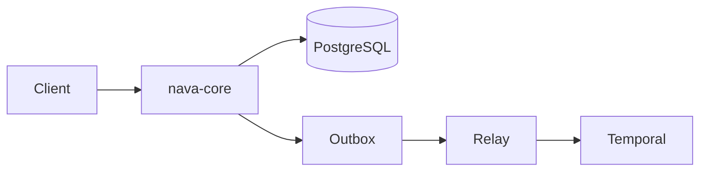
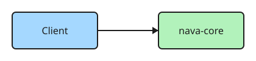

The viewer gives every diagram zoom, pan, reset and full screen. Authors write nothing extra. Remove this page when real diagrams exist.

## Mermaid

## Excalidraw

## Search target

The word flamingo appears only on this page, so search can be checked.
