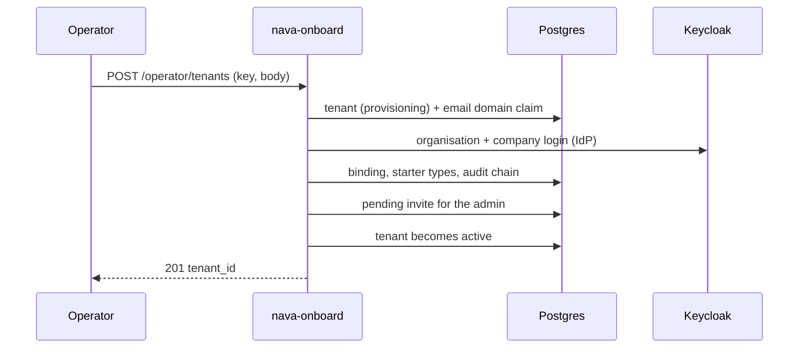

## In plain words

A new customer organisation is called a **tenant**. A platform operator (someone who runs the product, not the customer) creates it with one call, giving the customer's email domain, the customer's own company login system and the address of its first administrator. The customer gets a private space that no other customer can see, starter record types, and an invitation waiting for its administrator, who signs in with the company login. Sending the same call twice is safe: nothing is created twice.

## What you do

Call the operator API once per customer. It is a separate service from the tenant API, and only a token issued to a platform operator is accepted.

## Try it

Bruno: `S4.8 Onboard a new tenant`. With the setup from [the tour overview](index.md#before-you-start):

```sh
curl -i -X POST $ONBOARD/api/v1/operator/tenants \
  -H "Authorization: Bearer $OPERATOR" -H "Idempotency-Key: tour-acme-1" \
  -H 'Content-Type: application/json' -d '{
    "admin_email": "admin@acme-tour.test",
    "email_domains": ["acme-tour.test"],
    "identity_provider": {"provider_id": "oidc", "display_name": "Acme SSO", "config": {
      "clientId": "acme-client", "clientSecret": "dev-only-not-a-secret",
      "authorizationUrl": "https://93.184.216.34/auth",
      "tokenUrl": "https://93.184.216.34/token",
      "jwksUrl": "https://93.184.216.34/jwks",
      "useJwksUrl": "true", "defaultScope": "openid email profile"}}}'
```

The address `93.184.216.34` stands for the customer's login system. The platform refuses private and local addresses, so a public one is needed even on a laptop.

## What you see

```
HTTP/1.1 201 Created
{"state":"active","tenant_id":"c2296155-ca43-5af6-ad81-c8b156c9b4fa"}
```

The same call again, with the same key and body, answers `200` and the same body. The tenant id is derived from the operator and the key, so a retry finds the same tenant.

Three refusals, each with a problem body:

| Call | Answer |
|---|---|
| Same body, a new `Idempotency-Key` (the domain is taken) | `409 domain_claimed` |
| A tenant administrator's token instead of the operator's | `403 forbidden` |
| The same call on the tenant API (`$CORE`) instead of `$ONBOARD` | `501 not_implemented` |

What the call created, read from the database after the 201:

```
tenant          c2296155-…  active
email domain    acme-tour.test
admin invite    admin@acme-tour.test   pending
entity types    change (CHG), incident (INC), request (REQ), each at version 1
admins group    1 pointer row
```

The `incident` type also has a default access rule; `request` and `change` have none, so nobody can read their records until an administrator publishes one (step 7).

## What happens behind it



The tenant stays `provisioning` until the last step, so a failure halfway is finished by repeating the call with the same key. The first administrator has no local account and no password: they sign in through the tenant's company login, and the next group sync (step 4) places them in the tenant and uses up the invite. No email is sent. Details: [`nava-onboard`](../system/nava-onboard.md), [tenants](../database/tenancy.md), and the operator reference `docs/operator/onboarding.md`.

## Not built yet

- No operation abandons a half-onboarded tenant (AR-036).
- A refused invite is answered like a sent one, so an operator is not told when the admin cannot sign in.
- Onboarding is API only: no operator screen.
