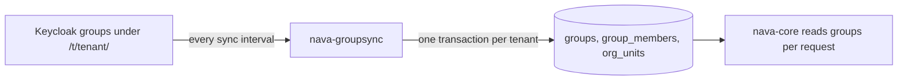

## In plain words

A group is a list of people who share a job, such as "loan officers" or "auditors". Access rules (step 7) name groups, so you give a whole team access once instead of person by person. The customer manages its groups in its identity system, the same place it manages its people. The platform copies them in on a timer: at most five minutes by default.

## What you do

Create a group in Keycloak under the tenant's path, `/t/<tenant id>/<name>`. The platform has no API for creating groups.

## Try it

Bruno: closest is `S5.1 Setup: look up Alice and tenant A's service-desk group`. Here the group is created with the Keycloak admin API (local admin account, development only):

```sh
KT=$(curl -fsS -X POST $KC/realms/master/protocol/openid-connect/token \
  -d grant_type=password -d client_id=admin-cli -d username=admin -d password=dev-only-admin \
  | sed -n 's/.*"access_token":"\([^"]*\)".*/\1/p')
A=00000000-0000-4000-8000-0000000000a1
PARENT=$(curl -sS -H "Authorization: Bearer $KT" $KC/admin/realms/nava/group-by-path/t/$A \
  | sed -n 's/^[^{]*{"id":"\([^"]*\)".*/\1/p')
curl -i -X POST $KC/admin/realms/nava/groups/$PARENT/children \
  -H "Authorization: Bearer $KT" -H 'Content-Type: application/json' -d '{"name":"loan-officers"}'
```

## What you see

Keycloak answers `201 Created` with a `Location` header. The platform does not know the group yet. Its table of tenant A's groups, before the next sync:

```
/t/00000000-0000-4000-8000-0000000000a1/admins
/t/00000000-0000-4000-8000-0000000000a1/auditors
/t/00000000-0000-4000-8000-0000000000a1/service-desk
```

`loan-officers` appears after the next sync cycle, which step 4 shows.

## What happens behind it



`nava-groupsync` reads each tenant's groups and members from Keycloak and writes them to the platform's tables, one transaction per tenant. Groups sit under `/t/<tenant id>/`, so a group of another tenant is never read into this one. The default interval is five minutes, which is why a group is never newer than that. This stack uses 15 seconds. Details: [`nava-groupsync`](../system/nava-groupsync.md), [users and groups](../database/identity.md).

## Not built yet

- No platform API or screen creates, renames or deletes groups; use the identity system.
- The seeded realm has only `admins`, `auditors` and `service-desk`. Domain groups such as loan officers need to be created, as here.
