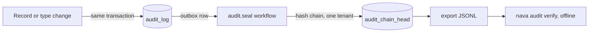

## In plain words

Every change to a record, a record type or an access policy is written to an audit log: who did it, when and what changed. The entries are chained: each one carries a fingerprint of the one before, so removing or editing an entry breaks the chain. An auditor can download the log and check it on their own computer with a standalone tool, without trusting the platform. Only administrators and the auditors group can read it, and fields hidden by a mask stay hidden in the log too.

## What you do

List the audit entries, export them, and verify the export offline.

## Try it

Bruno: `S14.3 listAuditEntries 200: the timeline, newest first`. There is no Bruno request for the export yet. After steps 6 to 9:

```sh
curl -sS -G $CORE/api/v1/audit/entries -H "Authorization: Bearer $ADMIN" \
  --data-urlencode subject_type=record --data-urlencode limit=4
curl -sS $CORE/api/v1/audit/entries:export -H "Authorization: Bearer $ADMIN" -o export.jsonl
go run ./cmd/nava audit verify export.jsonl
```

Entries are sealed into the chain by a background job, about a minute after the change on this stack, so wait before exporting.

## What you see

The list, newest first, one entry per change:

```json
{"items":[{"action":"state_change","domain":"record","subject_type":"record",
  "subject_id":"01a1d38a-629a-70ff-a578-e438265b5edf","actor_principal_id":"e4a636ce-…",
  "diff":[{"op":"replace","path":"/state","value":"under_review"}],
  "occurred_at":"2026-11-13T06:13:45.543671Z","seq":7,"version_before":1,"version_after":2, …}, …]}
```

Read by the auditor instead, the `diff` of a record with a masked field reads `{"redacted":"mask"}` for that field. Alice, in neither group, gets `403 forbidden`.

The export is a JSON Lines file: a header, an anchor, one line per sealed entry, and a trailer:

```
HTTP/1.1 200 OK
Content-Type: application/x-ndjson
Content-Disposition: attachment; filename="audit-export-01a1d38c-….jsonl"

{"kind":"header","format":"nava.audit.export/v1","tenant_id":"00000000-0000-4000-8000-0000000000a1", …}
{"kind":"anchor","genesis":true,"seq":0, …}
{"kind":"entry","sealed":true,"seq":1,"prev_hash":"0000…","entry_hash":"cb776397…", …}
  … 
{"kind":"trailer","anchor_seq":0,"last_seq":7,"head_hash":"c876d3e5…","count":7,"unsealed_count":1,"verifiable":true}
```

Verifying it:

```
$ go run ./cmd/nava audit verify export.jsonl
ok: seq 1..7 from genesis to head_hash c876d3e5…; 7 entries, 0 stubs, 1 unsealed
```

Changing one entry (here `"action":"create"` to `"action":"delete"` on seq 2) and verifying again:

```
tampered: line 4 (seq 2): envelope_sha256_mismatch: envelope_sha256 is not SHA-256(JCS(envelope))
exit status 1
```

## What happens behind it



An audit entry is written in the same transaction as the change, so there is no change without an entry. A background workflow (`audit.seal`, the one workflow running on `main`) later chains new entries: each `entry_hash` is SHA-256 of the previous hash and the entry's content. The verifier recomputes every hash from the export alone, checks the chain starts at the anchor and ends at the trailer's `head_hash`, and that the counts match. An entry not yet sealed is listed as `unsealed` and is outside the proof until the next seal. Details: [audit](../database/audit.md), [audit sealer](../workflows/audit-seal.md), the format in `docs/api/audit-export-v1.md`.

## Not built yet

- **The seeded demo tenants have no audit chain.** `seed.sh` writes tenants A and B directly, so they have no `audit_chain_head`, and the export answers `500 internal_error` ("the tenant has no audit chain head" in the server log). A tenant created by onboarding (step 1) has one. To run this step on tenant A, create its head and first seal row as onboarding does, then wait about a minute:

  ```sh
  A=00000000-0000-4000-8000-0000000000a1
  docker compose exec -T postgres sh -c 'PGPASSWORD=$(cat /run/pg_superuser_password) psql -q -v ON_ERROR_STOP=1 -U pgadmin -d nava' <<SQL
  BEGIN;
  SELECT set_config('app.tenant_id','$A',true);
  WITH ids AS (SELECT gen_random_uuid() hid, gen_random_uuid() sid),
  h AS (INSERT INTO audit_chain_head (tenant_id,id,next_seal_outbox_id,next_seal_at)
        SELECT '$A',hid,sid,now() FROM ids RETURNING 1)
  INSERT INTO outbox (id,tenant_id,kind,kind_version,dedupe_key,target_key,target_seq,causation_id,causation_depth,payload)
  SELECT sid,'$A','audit.seal',1,'audit.seal:1','audit.seal:'||sid,1,sid,0,'{}' FROM ids;
  COMMIT;
  SQL
  ```

- No audit screen, and no scheduled export. The Bruno collection has no request for the export.
