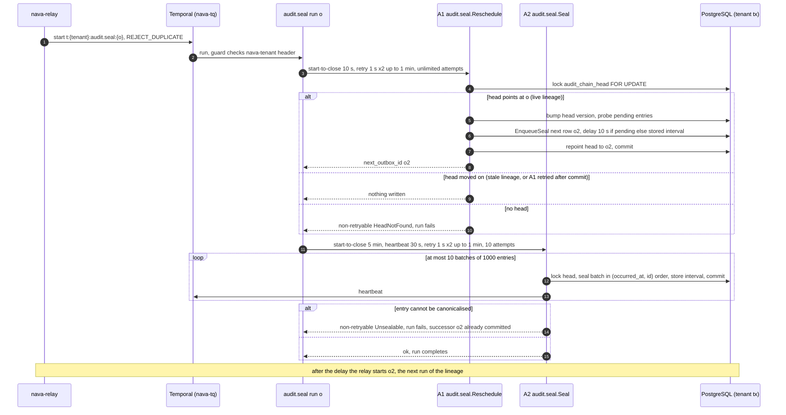

`audit.seal` hash-chains each tenant's audit entries (ADR-004 R16). It runs in the stack: `nava-worker` registers it in the production build (`cmd/nava-worker/main.go:331-336`), with its two activities, on `nava-tq`. Each run is one link in the tenant's **seal lineage**: the run commits its successor's start row first, then seals.

## Trigger

A start row of kind `audit.seal` (`internal/outbox/outbox.go:110`), started by the relay as `t:<tenant>:audit.seal:<o>`, where `o` is the row's outbox ID. Three producers write that row; see [the durable path](outbox-relay-worker.md#producers):

- **Onboarding** writes the tenant's first row with a plain `INSERT` next to the `audit_chain_head` row.
- **A1 of the previous run** writes the next row through `outbox.EnqueueSeal` with a delay (`internal/audit/seal/seal.go:140`).
- **`chain:reseed`** starts a new lineage through `outbox.EnqueueReseed`.

The workflow input is the relay's `outbox.Delivery`, which the workflow does not read. A1 takes `o` from the workflow ID (`RunOf`, `activities.go:163`), and the tenant comes from the guard (I2).

## Sequence

## Activities, timeouts and retries (quoted by hand; checked against the footer sha)

| Activity | Registered name | Start-to-close | Heartbeat | Retry policy | Source |
|---|---|---|---|---|---|
| A1 `Reschedule` | `audit.seal.Reschedule` | 10 s (`A1StartToClose`) | none | `A1RetryPolicy()`: initial 1 s, coefficient 2, max interval 1 min, **unlimited attempts** (TICK-587) | `workflow.go:24`, `workflow.go:43-50` |
| A2 `Seal` | `audit.seal.Seal` | 5 min (`A2StartToClose`) | 30 s (`A2HeartbeatTimeout`) | `A2RetryPolicy()`: initial 1 s, coefficient 2, max interval 1 min, **10 attempts** (`A2MaxAttempts`) | `workflow.go:25-26`, `workflow.go:33`, `workflow.go:53-60` |

- **Why A1 is uncapped**: A1 commits the next run. A capped A1 that ran out of attempts during an outage would end the tenant's lineage with nothing to report it. A1 is idempotent, so retrying until the outage ends is safe. Proof: `TestWorkflowA1OutlastsAnOutage`, `TestWorkflowActivityOptions`.
- **Why A2 heartbeats**: one A2 call seals at most 10 batches (`DefaultMaxBatches`, `activities.go:49`) of 1000 entries (`BatchSize`, `seal.go:40`) and heartbeats after each committed batch. An attempt on a dead worker is retried after 30 s, not 5 min. A longer backlog is continued by the next run. Proof: `TestBoundedA2ContinuesInNextRun`.
- **Interval**: 10 s after a run that sealed anything, otherwise the stored interval doubled, up to 300 s (`seal.go:45-46`, `NextInterval` at `seal.go:68`, ADR-004-E7). With pending work A1 books 10 s itself. Proof: `TestRescheduleWithPendingWorkBooks10s`, `TestRescheduleIdleBooksStoredInterval`, `TestIdleTenantSealedWithin300s`.

## Failure handling

| Failure | Type | Retried | Result | Proof |
|---|---|---|---|---|
| Workflow ID is not a sealer ID | `nava.audit.seal.NoRun` | no | run fails | `TestRunOf` |
| Tenant has no `audit_chain_head` | `nava.audit.seal.HeadNotFound` | no (otherwise A1 would retry every minute forever) | run fails | `TestRecordedHistoriesFailureType` |
| Entry cannot be canonicalised (poison) | `nava.audit.seal.Unsealable` | no | run fails; the entry is never skipped, because skipping would break the order. The successor, already committed, meets it again and the alert fires | `TestUnsealableEntryFailsItsBatch`, `TestPoisonBlocksTenantAndAlerts` |
| Worker killed between A1 and A2 | | A2 retried | sealed by this run or the next | `TestKillBetweenA1AndA2` |
| PostgreSQL or PgBouncer down | | A1 retries without a cap | lineage survives | `TestWorkflowA1OutlastsAnOutage` |

The `workerguard` records `Unsealable` and `HeadNotFound` as is (their messages are constants); `NoRun` is withheld as `nava.Opaque` because its message carries a parse error (`activities.go:33-37`). Proof: `TestSealFailureTypesPassUnchanged`.

## Idempotency

- **Start**: the workflow ID `t:<tenant>:audit.seal:<o>` with `REJECT_DUPLICATE`.
- **A1**: the head lock plus the lineage check. A retry after commit finds the head moved on and writes nothing; two concurrent A1s produce one successor. The next row's dedupe key is derived from the head version (`SealDedupeKey`). Proof: `TestA1RetriedAfterCommitStillSeals`, `TestConcurrentRescheduleOneSuccessor`, `TestWorkflowRunsA2AfterRetriedA1`.
- **A2**: every batch takes the head lock (R15) and updates only rows still unsealed, so overlapping runs never assign a `seq` twice. Proof: `TestConcurrentSealersNeverDuplicateSeq`, `TestSealWaitsForHeadLock`, `TestWorkflowRunsA2WhateverA1Returned`.

## Tenant scoping

The tenant is never an argument. Both activities read it from the guard-verified `nava-tenant` header and open their transaction with `workerguard.InTenantTx`; with no verified tenant they open none. A1's result holds references only. Proof: `TestNoTenantNoTransaction`, `TestRescheduledIsReferencesOnly`, `TestSealTenantIsolation`.

## Determinism and versioning

- **Replay**: `TestReplayRecordedHistories` replays the committed histories in `internal/audit/seal/testdata/histories/`: `a1-retried.json`, `head-not-found.json`, `next-run.json`, `poison.json`, `stale.json`. `TestRecordedHistoriesShape` requires exactly that set (append-only).
- **`workflowcheck`** runs on `./internal/audit/seal` (and `./internal/workflow/...`) (`scripts/ci/workflowcheck.sh:13`).
- **No continue-as-new and no child**: the only way to the next run is A1's outbox row, which the relay starts and the head fences (`workflow.go:79-82`). Proof: `TestWorkflowStartsNoChildAndNeverContinuesAsNew`.
- **No `GetVersion`.** Seal rows are written at `kind_version` 1 and the workflow does not read its input.
- **Registration**: `TestRegisterSealer` checks the workflow and both activities are registered; `TestRegisterSealerActivitiesOnly` checks `NAVA_WORKER_WORKFLOWS=off` registers activities only; `TestComposeWorkerWorkflowsOn` checks `compose.yaml` never turns it off.
