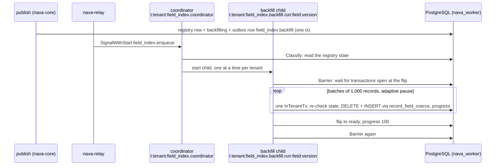

**Built on the story branch `TICK-739/filterable-fields` (S21), not yet on
`main`.** Normative note:
[field-index-backfill.md](../../../data/field-index-backfill.md) (P7-05,
TICK-745, with TICK-974, TICK-976, TICK-980 and TICK-991). Measurements:
[field-index-measured.md](../../../data/field-index-measured.md).

When a publish flags a field on a type that already has records, the field's
registry row starts in `backfilling` and every list filter on it answers
`422 field_not_ready`. This workflow copies the existing values into the
[side table](../database/field-index.md) and flips the row to `ready`. A record
written at any moment across either flip is in the side table afterwards.

## Flow

## The pieces

| Piece | What it does |
|---|---|
| Outbox row | Kind `field_index.backfill`, written only by `outbox.EnqueueFieldIndexBackfill` in the publish transaction. Dedupe key `field_index.backfill:<field>:<version>`. |
| Relay | Never starts the backfill. It signal-with-starts the tenant's coordinator. The tenant is the outbox row's: a payload `tenant_id` that differs fails closed, the row is marked dead, and Temporal is not called. |
| Coordinator | One per tenant (`t:<tenant>:field_index.coordinator`). Dedups on the outbox id and on `(field, requested_version)`, runs one child at a time in arrival order, continues as new after 100 items, and completes after 5 minutes idle. A failed child is a `Warn` log line with `alert=true` and the field id, and the queue moves on. |
| Backfill child | `t:<tenant>:field_index.backfill.run:<field>:<version>`. The activities read the field and pinned version from the workflow id, never from an argument. |
| Barrier | Takes `pg_current_snapshot()` once, plus a fence xid right after it, and waits until every transaction in the snapshot's `xip` and in `[xmax, fence)` has ended ([ADR-006-E1](../adr/adr-006-e1.md)). The heartbeat keeps only the bounds `{xip, lo, hi}`, so it stays a fixed size however many xids were handed out (TICK-980; `TestBarrierHeartbeatKeepsWaitSetBounds` holds it under 512 bytes). Polls `pg_xact_status` 1 s apart, backing off to 10 s, holding no connection between polls. A lost worker resumes from the same snapshot. A removed or re-versioned registry row ends the wait at the next poll. After 15 minutes it raises `field_index_barrier_slow` once and keeps waiting. |
| Batch | One `InTenantTx`: the registry row `FOR SHARE` (stop unless still `backfilling` at the pinned version), the next 1,000 ids `FOR SHARE`, DELETE then INSERT from `record_field_coerce`, progress as a whole percentage capped at 99. Values that did not coerce are added to `nava_field_index_uncoerced_total` after the commit (TICK-974). Activity arguments and results are references only (`{cursor}`), never data. |
| Pause | Starts at 500 ms and is driven only by the batch duration the workflow measures. It doubles (to 4 s) when the median of the last 5 batches is over 1.5× a slowly following baseline, and halves (down to 500 ms) within 1.25× (TICK-991). |
| Ready | Flips to `ready`, progress 100, only if still `backfilling` at the pinned version, then runs the barrier again. |

`nava_worker` plans with `plan_cache_mode = force_custom_plan`
(`db/grants.yaml`, TICK-990): under the default, the keyset step switched to a
generic plan that took 821 ms per batch instead of 17 ms.

## Why no record is missed

A writer that inserted a record before the flip to `backfilling` committed saw
no registry row, so the trigger copied nothing; if it commits after the batch
passed its id, that record would be missed. Such a writer held an xid when the
flip committed, so it is in the barrier's wait set, and the batches start only
after it ends. Every later write sees the registry row, because writers run
READ COMMITTED (the trigger refuses anything else, TICK-979) and the trigger's
registry read takes its own snapshot. `TestR1WriterAcrossTheFlip` proves it
both ways: with the barrier replaced by a no-op, the same schedule leaves
exactly one record missing.

## Tenant isolation

- Temporal: `field_index.coordinator` and `field_index.backfill.run` are on
  the server's platform allow-list. `field_index.backfill.run` is
  **child-only**: a relay `StartWorkflowExecution` or
  `SignalWithStartWorkflowExecution` of it is denied, so no backfill runs
  around the coordinator's one-per-tenant rule (see [Temporal
  authorization](../security/05-temporal.md)).
- Only `internal/fieldindex` names these workflow types
  (`TestOnlyFieldindexNamesItsWorkflowTypes`).
- A coordinator item naming another tenant's field finds no registry row under
  RLS, so nothing runs and nothing is written
  (`TestOtherTenantsFieldWritesNothing`). Attack row 3b drives the real
  coordinator and backfill with a forged payload (see [S21 attack
  paths](../stories/s21.md#attack-paths)).

## Measured (TICK-992, reference machine, story head `9ec4e1f5`)

| Measure | Result |
|---|---|
| 400k-record field, alone | 8 min 14 s, 417 batches, batch p50 163 ms, diff 0 |
| Same, under 8 clients of live writes | 10 min 26 s, diff 0 |
| Live-write p95 during the backfill (D10: ≤ +25%) | −7.4% against the control before, +4.8% against the control after: met |

## Known limits

- The keyset walks `records (tenant_id, id)` filtered by type, so a tenant with
  many types reads past other types' rows.
- Progress is approximate: the type is counted once per child per worker.
- The uncoerced count is at least once: a retried batch counts its skipped
  values again. It is an alerting rate, not a ledger.
- Removal (`field_index.remove.run`, D11) is S22; until then a publish that
  drops a flag is refused with `422 filterable_field_removal_unavailable`.
