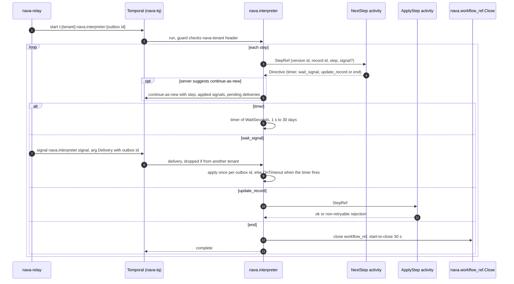

Registered in the production build and running in the stack since S11b. `interpreterActivities` (`cmd/nava-worker/interp_default.go:19-24`) returns `productionActivities` (`cmd/nava-worker/interp_ports.go:29-41`):

- the definition store is `workflowdefs.Reader`, which reads published versions from `workflow_definition_versions` (P3-41);
- the record reader and writer are `recordports`. The writer writes through the records pipeline as `source=workflow`, with its `TxRunner` on a separate pipeline pool (P3-43);
- `workerguard.WaitTracker` and `workerguard.CauseTracker` keep `workflow_ref.record_changed_signal_id` and the run's newest `workflow_cause` row.

Every port reaches the database through `workerguard.InTenantTx`. With workflows off (the activity-only worker) it returns nil, and `registerInterpreter` (`cmd/nava-worker/interp.go:14-20`) registers nothing. The `interptest` build still wires file-backed fakes for the S11a demos. With `NAVA_INTERPTEST_PORTS=db` it runs the production ports instead, which the crash case uses. Proof: `TestProductionBuildWiresTheDatabasePorts`, `TestProductionBuildInterpreterNeedsAPool`, `TestProductionBuildWithWorkflowsOffRegistersNoInterpreter`, `TestProductionBuildLinksNoFakes`, `TestInterptestBuildWiresTheFakes`, `TestInterptestBuildProductionPorts`, `TestInterpreterCrashRealPipelineAppliesOnce`.

A tenant admin publishes a definition with `publishWorkflowDefinitionVersion`. A record write then starts it through the pipeline's `EventSink` (`internal/records/pipeline/eventsink`, P3-42): see [the durable path](outbox-relay-worker.md#producers). The worker pools are sized in [benchmarks](../benchmarks/index.md) ("Worker pipeline pool").

## Trigger

A start row of kind `nava.interpreter` (`internal/outbox/outbox.go:105`), written only by `outbox.EnqueueStart` under a claimed `cascade.Claim` (ADR-001 A5-6). In production the one producer is the records pipeline's `EventSink`. It enqueues a start on a write whose entity type and operation match the trigger (`record.created` or `record.updated`) of a published definition's current version. The claim is a `cascade_start` row keyed on the record, the definition and the causation origin, so a cascade cycle starts nothing (I9). The relay starts it as `t:<tenant>:nava.interpreter:<outbox id>`.

The input is `workerguard.RunInput`: the relay's `outbox.Delivery` with payload `{definition_version_id, record_id}` and nothing else (`workflow.go:52-55`). The definition version is pinned at start; the workflow never reads "latest". Any other payload is a non-retryable `RejectInput` (`TestStartInputRefused`).

## Sequence

## Activities, timeouts and retries (quoted by hand; checked against the footer sha)

| Activity | Registered name | Start-to-close | Retry policy | Source |
|---|---|---|---|---|
| `NextStep` | `nava.interpreter.NextStep` | 10 s | `ActivityRetryPolicy()`: initial 1 s, coefficient 2, max interval 1 min, 10 attempts | `workflow.go:20`, `workflow.go:27-42` |
| `ApplyStep` | `nava.interpreter.ApplyStep` | 10 s | same | same |
| `CloseWorkflowRef` | `nava.workflow_ref.Close` | 30 s | SDK default | `internal/workerguard/workflowref.go:105-110` |

- The 10 s cap is the P3-24 contract: an attempt on a dead worker is retried only when it expires, so it sets how fast a crash recovers. Proof: `TestApplyStepStartToCloseWithinContract`.
- The SDK default retries forever; the explicit policy fails the run after about six minutes of backoff. Proof: `TestActivityRetryPolicyIsBounded`, `TestPersistentNextStepFaultFailsTheRun`, `TestPersistentApplyStepFaultFailsTheRun`.
- Wait bounds of a timer or `wait_signal`: 1 s to 30 days (`internal/workerguard/directive.go:76-77`). Proof: `TestWaitBoundsMatchTheGuard`.

`NextStep` is the one activity whose result the guard lets carry a `workerguard.Directive`, and `nava.interpreter` the one workflow that may receive one (`directive.go:41,49`).

## Signals and idempotency

- **Start**: the workflow ID with `REJECT_DUPLICATE`; the start row's ID is the claim's outbox ID, so one claim is one start.
- **Signals**: one signal name, `nava.interpreter.signal` (`interp.go:51`). Its argument is the relay's `Delivery`, payload `{"signal": <signal id>}`. A delivery is applied only if it is the signal the current step awaits and its **outbox ID** is new (`AppliedSignals.TryApply`, `workflow.go:203,237`, I7); others are dropped. The applied set covers 48 h, longer than the relay's 24 h redelivery age. Proof: `TestSignalAppliedOnce`, `TestSignalWithoutSignalIDDropped`, `TestSignalAppliedOnceAcrossContinueAsNew`.
- **`ApplyStep`**: delivered twice, it writes once. Proof: `TestApplyStepDeliveredTwice`.
- **`workflow_ref` close**: keeps the first `closed_at`, so a retry is a no-op. Proof: `TestCompletedWorkflowClosesItsWorkflowRef`.

## Failure handling

| Failure | Result | Proof |
|---|---|---|
| Start input or carried refs malformed | non-retryable `RejectInput`, run fails | `TestStartInputRefused`, `TestRunRefsRefused` |
| Business rejection (validation, illegal transition, forbidden) or missing version, record or step | non-retryable `workerguard.Rejected` with fixed text, run fails | `TestBusinessRejectionFailsTheRun` |
| Directive of an unknown kind or with a missing edge | non-retryable `RejectDirective`, never a panic (AR-042) | `TestKindDefaultFailsWithoutPanic` |
| Any other activity error | retried by the policy above; the guard withholds its text as `nava.Opaque` | `TestNextStepFailureWithheld` |
| Cancelled during a wait | the wait ends with the cancellation | `TestCancelDuringWait` |

## Tenant scoping

The tenant is never in the input. Activities read it from the guard-verified header and load the version and record in that tenant's transaction, so another tenant's version or record is "not found". The history holds IDs only, never a definition or record value. Proof: `TestCrossTenantIsNotFound`, `TestHistoryHoldsNoDefinitionLiteral`, `TestSignalAbsentPassesGuard`.

## Determinism, continue-as-new and versioning

- **Continue-as-new**: when `GetContinueAsNewSuggested()` is true, only between steps, after `NextStep` returns and before the wait starts (`workflow.go:138`). The new run carries the step, its cause, the applied-signal set and every delivery not yet acted on (`workflow.go:255-276`); the guard checks that input twice (see [the durable path](outbox-relay-worker.md#the-workerguard-interceptor)). Proof: `TestContinueAsNewResumesAtSameStep`, `TestContinueAsNewWaitsForTheWaitToEnd`, `TestPinnedAcrossContinueAsNew`.
- **Version pinning**: a run keeps the definition version it started with, across continue-as-new. Proof: `TestInFlightRunKeepsItsVersion`.
- **Replay**: `TestReplayRecordedHistories` replays every committed history in `internal/workflow/testdata/histories/` (`continue-as-new.run1.json` to `run5.json`, `else-default.json`, `signal.json`, `timeout.json`). `TestHistorySetRequired` requires the set, `TestHistoriesAppendOnly` forbids editing or deleting one on `main`, `TestHistoriesHoldReferencesOnly` checks they carry no record data, and `TestReplayCatchesNonDeterminism` proves the gate fails on a changed command sequence. `NextStep` itself is deterministic for the same input (`TestNextStepIsDeterministic`).
- **`workflowcheck`** runs on `./internal/workflow/...` (`scripts/ci/workflowcheck.sh:13`).
- **No `GetVersion` today.** No non-test file calls `workflow.GetVersion`, and the retired-histories manifest is empty (`internal/workflow/testdata/retired-histories.json`). Start rows carry `kind_version` 1 in the `Delivery`, and the workflow does not branch on it. When a code change needs `GetVersion`, ADR-003 governs it: an old arm is retired only by raising `minSupported`, and the call is never deleted. The tooling is ready: `TestScanGetVersionCalls`, `TestRetiredHistoriesManifest`, `TestReplayGetVersionKeepsHistoriesGreen`.
