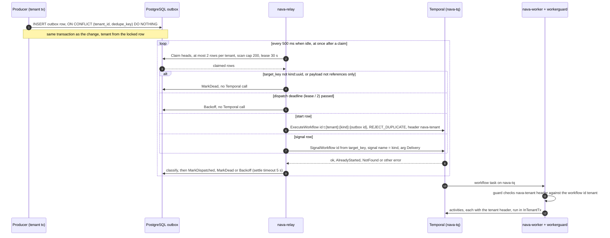

Every Temporal workflow on `main` is started or signalled from one place: an `outbox` row written in the same tenant transaction as the change that caused it (I6). `nava-relay` is the only process that turns a row into a Temporal call, and `nava-worker` runs the workflow behind the `workerguard` interceptor. `nava-core` never starts a workflow; it talks to Temporal only for its readiness probe.

There are exactly two workflow kinds, both listed in `internal/outbox/outbox.go`. Each has one entry point that may enqueue its start (`outbox.go:244`):

| Kind | Start goes through | Registered in | Page |
|---|---|---|---|
| `audit.seal` | `outbox.EnqueueSeal` | production build, runs in the stack | [Audit sealer](audit-seal.md) |
| `nava.interpreter` | `outbox.EnqueueStart`, under a `cascade.Claim` | `interptest` build only | [Workflow interpreter](nava-interpreter.md) |

## The path

## Producers

| Producer | Writes | Through | Source |
|---|---|---|---|
| Record write pipeline `EventSink` | `nava.interpreter` start | `cascade.ClaimStart` claims the start key, then `outbox.EnqueueStart`; a repeat claim enqueues nothing and writes `AuditSuppressed` (A5-4) | `internal/records/pipeline/pipeline.go:212-227`, `internal/records/cascade/cascade.go:117`, `internal/outbox/outbox.go:204` |
| Interpreter signals from a record write | signal to an open `nava.interpreter` | `outbox.EnqueueAtVersion` at the version the write gave the record | `internal/records/pipeline/pipeline.go:217` |
| Sealer A1 (`audit.seal.Reschedule`) | next `audit.seal` start | `outbox.EnqueueSeal` with `WithDelay` (10 s with pending work, else the stored interval, up to 300 s) | `internal/audit/seal/seal.go:140`, `internal/outbox/outbox.go:338` |
| `chain:reseed` | a new `audit.seal` lineage | `outbox.EnqueueReseed`, its own dedupe key | `internal/audit/reseed/reseed.go:72` |
| Onboarding (`nava-onboard`) | the tenant's first `audit.seal` start | a plain `INSERT` with the same column list as `EnqueueSeal` | `internal/onboard/store.go:255-266` |

**Onboarding writes the row directly.** `nava_onboard` has INSERT only, so `outbox.EnqueueSeal`, which locks the head and reads back, is not usable. The row is the same row, written with a plain `INSERT`, no `RETURNING` and no conflict clause. The head insert is the idempotency record: if the head already exists, nothing else is written. `TestSealInsertMatchesOutbox` keeps the column lists equal.

**On `main` no production sink starts the interpreter yet.** `nava-core` builds the pipeline with `pipeline.NoopSink{}` (`internal/server/api.go:111`); S11b replaces it (P3-42) and is in progress on its story branch. Today only `cmd/demo-outbox` and `cmd/demo-interpreter` call `EnqueueStart`.

## Workflow ID and start options

- **Workflow ID** `t:<tenant_id>:<target_key>`, where a start row's `target_key` is `<kind>:<its own outbox id>` (`dispatch.go:336-348`). The relay accepts only a `target_key` of `<kind>:<canonical uuid>` with a kind matching `^[a-z][a-z0-9._-]{0,99}$`, so the ID carries no free text and no PII. Proof: `TestWorkflowID`, `TestInvalidTargetKeyIsDead`.
- **Start options** (`dispatch.go:319-328`): `WORKFLOW_ID_REUSE_POLICY_REJECT_DUPLICATE` and `WorkflowExecutionErrorWhenAlreadyStarted: true`, task queue `relay.TaskQueue`. Proof: `TestStartRequest`.
- **Search attribute** `NavaTenantId` is set from the outbox row's tenant, never from the payload. It is for visibility queries only. The tenant is bound by the workflow ID and the `nava-tenant` header, which the client propagator sets from `workerguard.ContextWithTenant` (`dispatch.go:239`).
- **One queue, `nava-tq`.** `relay.TaskQueue = "nava-tq"` (`internal/relay/dispatch.go:29`) and the worker polls the same queue (`cmd/nava-worker/main.go:45`). It is the only queue on the Temporal Authorizer's allow-list.

## Outcomes (`classify`, `dispatch.go:354-370`)

| Situation | Outcome | Row becomes | Proof |
|---|---|---|---|
| Call succeeded | `dispatched` | dispatched | `TestStartRequest`, `TestSignalRequest` |
| Start returned `WorkflowExecutionAlreadyStarted` | `already_started`, counted as dispatched: a redelivered start starts nothing | dispatched | `TestStartAlreadyStartedIsDispatched` |
| Signal returned `NotFound` (also what Temporal returns for a completed workflow) | `target_missing`, terminal at once, alert metric `outbox_relay_signal_target_missing` | dead | `TestSignalTargetMissingIsDeadWithAlert` |
| Any other error | `backoff`, cause is fixed text plus the gRPC code, never the error message | pending, retried | `TestEveryDispatchErrorBacksOffWithACleanCause` |
| Backoff on a row older than `MaxRedeliveryAge` | `dead` | dead | `TestBackoffDeadIsCounted` |

Two cases are settled **without a send** (`dispatch.go:222-233`):

- **Invalid target**: `target_key` or `kind` not in the one form above → `MarkDead` with `relay: target_key is not <kind>:<uuid>`. Proof: `TestInvalidTargetKeyIsDead`.
- **Invalid payload**: the payload is not references only (`outbox.ValidatePayload`, CI-7), for example a row written around `Enqueue*` → `MarkDead`, alert metric `outbox_relay_payload_refused`. It never reaches Temporal. Proof: `TestRecordDataPayloadIsRefusedBeforeDispatch`; the database check refusing such an insert: `TestPayloadCheckRefusesDirectInsert`.

A row reached after its dispatch deadline is backed off without a call, so a late call can never overtake the successor that took over its lease (`TestDeadlineBacksOff`). A settle that finds its lease taken is `lease_lost` and writes nothing (`TestRedeliveredStartAfterSettleIsLeaseLost`).

## Timing (quoted by hand; checked against the footer sha)

| Value | Code | Source |
|---|---|---|
| Poll interval when a poll claimed nothing | 500 ms | `cmd/nava-relay/main.go:51` |
| Rows claimed per tenant per poll | 2 (`PerTenant`) | `internal/relay/relay.go:33` |
| Pending rows scanned per tenant per poll | 200 (`ScanCap`) | `internal/relay/relay.go:35` |
| Lease | 30 s | `internal/relay/relay.go:115` |
| Dispatch deadline | lease / 2 after the claim | `internal/relay/dispatch.go:188` |
| Rows dispatched at once per poll | 8 | `internal/relay/dispatch.go:124` |
| Settle timeout (runs even during shutdown) | 5 s | `internal/relay/dispatch.go:83` |
| Backoff | 1 s, doubled per attempt, capped at 5 min | `internal/relay/relay.go:118,121` |
| Max redelivery age, then dead | 24 h | `internal/relay/relay.go:39` |
| Applied-signal dedupe window in the workflow (must exceed the redelivery age) | 48 h | `internal/workerguard/dedupe.go:13` |

## Idempotency keys

| Step | Key | Where it is enforced | Proof |
|---|---|---|---|
| Producer write | `dedupe_key`, `UNIQUE (tenant_id, dedupe_key)`, insert `ON CONFLICT DO NOTHING` | `internal/outbox/outbox.go:139-143` | `TestCI10_DuplicateDedupeKeyWritesOneRow` |
| Start | the workflow ID, with `REJECT_DUPLICATE` | `dispatch.go:319-328` | `TestStartAlreadyStartedIsDispatched` |
| Signal | the outbox ID, carried in `Delivery.OutboxID` and applied once by `AppliedSignals.TryApply` in the workflow (I7) | `internal/workerguard/dedupe.go:31` | `TestSignalAppliedOnceAcrossContinueAsNew`, `TestAppliedSignalsWindow` |
| Activities | each activity is idempotent on its own key; see the workflow pages | | |

## The `workerguard` interceptor

`cmd/nava-worker` installs the guard on the worker, and `relay` builds its client with `workerguard.ConfigureClient`, so the `nava-tenant` header travels with every start, signal and activity.

- **Start**: a missing `nava-tenant` header, or one that differs from the workflow ID's tenant, fails the workflow non-retryably (`guard.go:154-160`). Proof: `TestStartGuard`.
- **Signal**: from another tenant, or with no header, it is dropped and the workflow keeps running (`guard.go:191-198`). Proof: `TestSignalGuard`.
- **Activity**: a missing or different header fails it non-retryably; otherwise the tenant is put on the context for `InTenantTx` (`guard.go:604`). Proof: `TestActivityGuard`.
- **Arguments and results**: every activity, child and continue-as-new argument must be references only (CI-7), and a result that is not fails. Proof: `TestContinueAsNewArgsGuard`.
- **Continue-as-new, checked twice.** `NewContinueAsNewError` checks the header and input when the command is built (`guard.go:352-366`). `ContinueAsNewError` is plain data, so workflow code could change it afterwards; `ExecuteWorkflow` checks it again on the way out, and the input must be one the first check saw (`guard.go:161-178`). Proof: `TestAdversarialContinueAsNewInputRewrittenAfterGuard`, `TestAdversarialContinueAsNewHeaderRewrittenAfterGuard`.
- **`nava.workflow_ref.Close`** (`workflowref.go:34`, registered at `workflowref.go:52-54`): a relay-started workflow calls it last. It finds its `workflow_ref` row from the workflow ID, never from an argument, runs in `InTenantTx` with the header tenant and keeps the first `closed_at`, so a retry is a no-op. Start-to-close 30 s, SDK default retries (`workflowref.go:105-110`). Proof: `TestCompletedWorkflowClosesItsWorkflowRef`, `TestWorkflowRefCloseIsTenantScoped`, `TestWorkflowRefCloseWithWrongHeaderTouchesNothing`.

## Versioning

Neither workflow calls `workflow.GetVersion` today. Every row a producer on `main` writes carries `kind_version` 1 (the seal producers fix it; the demo producers pass 1), and the relay passes `kind_version` to the workflow in `outbox.Delivery`; no workflow branches on it yet. A later code change to the interpreter follows ADR-003. Details and proofs are on each workflow page.
