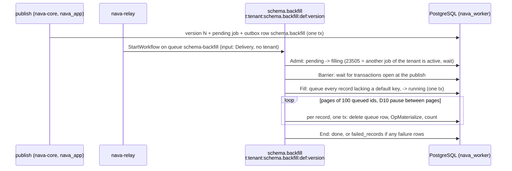

**Built on the story branch `TICK-740/search-finish` (S29), not yet on
`main`.** Normative note: [schema-backfill.md](../../../data/schema-backfill.md)
(TICK-920). Design: [ADR-009](../adr/adr-009.md) D2 to D9.

A publish that gives a field a default writes a `pending` job. This workflow
writes that default into every existing record of the type that lacks it, one
record per transaction, through the one record write path (I4). It is
tenant-scoped by its workflow id, runs as `nava_worker`, and starts nothing
else.

## Flow

The states are on the [tables page](../database/schema-backfill.md), and the
full state diagram is in the normative note.

## The pieces

| Piece | What it does |
|---|---|
| Outbox row | Kind `schema.backfill`, written only by the publish transaction (`entitytypes.queueBackfill`) or the D15 rollout migration, in the same form as `outbox.EnqueueSchemaBackfill`. Payload `{entity_definition_id}` only, because `outbox_payload_check` admits UUID values only. The target version is in `target_seq` and the dedupe key `schema-backfill:<def>:<version>`. The causation audit id stays on the job row (PLAN-010 D-10-10). |
| Relay | Starts `t:<outbox.tenant_id>:schema.backfill:<def>:<version>` on task queue `schema-backfill`. The tenant comes from the outbox row. A payload that is not exactly `{entity_definition_id}`, a `tenant_id` key included, is marked dead with no call to Temporal. A redelivered row gets `WorkflowExecutionAlreadyStarted`, which acknowledges it. |
| Admit | The `pending -> filling` UPDATE, under the partial unique index that allows one active job per tenant. A `23505` leaves the job pending; the workflow retries after a timer, 10 s backing off to 60 s. Writes the "started" audit entry. |
| Barrier | The ADR-006 D9 snapshot barrier (`internal/fieldindex/barrier`, moved out of the field-index backfill with no change). A record written by a transaction that was open at the publish is committed before the queue is filled. |
| Fill | One transaction: inserts every record of the type with `NOT (data ?& default_keys)` into the queue and sets `running`. |
| Page | Reads up to 100 queued ids, with no row lock. Each id gets its own `InTenantTx` with `SET LOCAL synchronous_commit = off`, which deletes the queue row, rewrites the record through `pipeline.Write(OpMaterialize)` and adds one to `rewritten` or `skipped`, all committing together. A version conflict or deadlock rolls back and leaves the id queued for a later pass. A refusal or database error rolls back, then a separate transaction moves the id to the failures with its code. No savepoints. |
| Pause | The ADR-006 D10 pacer (`fieldindex.Pacer`), driven by the page duration. |
| Supersede | Admission and every page check for a newer job of the type (D8). If one exists, this job becomes `superseded`, its queue and failures are deleted, and the workflow ends. A publish never waits on a running job. |
| End | `done`, or `failed_records` when any failure row remains. Writes the "finished" audit entry with the counts. |
| CheckR6 | After `failed_records`, sleeps `NAVA_SCHEMA_BACKFILL_R6_AFTER` (default 168 h). If the job is still `failed_records` and still the newest of its type, it increments `nava_schema_backfill_r6_tripped_total` and logs one WARN line (ADR-009 R6). |

## What a rewrite does to a record

The rewrite is `OpMaterialize` on the [write
pipeline](../system/core-write-pipeline.md#opmaterialize-the-schema-backfill-write):
an empty patch, the current version's defaults applied, validated as any write
is. When nothing is missing, nothing is written. When something is: `version`
moves by one (the ETag changes), `schema_version` becomes the current version,
`updated_at` does **not** change, one `update` audit entry is written with
`actor_system = schema-backfill`, and no workflow is started or signalled
(D3 to D6). A user edit that lands first wins, and the record is tried again
later.

## Audit

- One `update` entry per rewritten record, caused by the publish entry (depth
  + 1). A rollout job has no publish, so its entries start a new origin.
- Two entries on the entity type: "started" in the admission transaction and
  "finished" with the counts. Both use domain `config`, action `update`,
  subject the entity definition, and a diff of `{"backfill": {state,
  target_version, counts}}`, following the numbering-mode precedent. No new
  audit action was added. No entity-type version moves.

## Worker

`cmd/nava-worker` runs a second worker on task queue `schema-backfill`
(`registerSchemaBackfill`). Its `MaxConcurrentActivityExecutionSize` is
`NAVA_SCHEMA_BACKFILL_CONCURRENCY` (default 4). That is the D7 cap of four
tenants' pages at once per replica. The record write goes through the
`recordports` adapter, because `internal/schemabackfill` may not import the
pipeline.

## Tenant isolation

- **Temporal.** `schema.backfill` is a platform workflow type and is
  **start-only**: only nava-relay may start it, and no worker command, child or
  continue-as-new can name it. `schema-backfill` is a platform task queue that
  carries no other type. See [Temporal
  authorization](../security/05-temporal.md).
- **Activities.** Every activity reads the job from the workflow id
  (`workerguard.TenantOf`), checks it against the guard's tenant, names
  `tenant_id` in every statement, and runs under RLS. A job with no row under
  RLS is a non-retryable stop, `nava.schema_backfill.NoJob`.
- **History.** Every argument, result and heartbeat is a reference: results are
  optional pointers to the definition id, and counters live only on the job
  row (`TestActivityValuesAreReferencesOnly`).
- **Attack rows** S29 4, 5 and 6 drive `OpMaterialize`, the real workflow and
  the real relay with another tenant's ids and a forged payload (see
  [S29](../stories/s29.md#attack-paths)).

## Not measured here

- The 100k-record run with four live writers (CI-12, TICK-927) is out of scope
  for this story under the consolidation of 2026-11-26 and stays in backlog.
  CI-4 runs four live writers with no lost update (`TestBackfillWithLiveWriters`),
  but does not measure p95.
- A real worker kill under `synchronous_commit = off` is not simulated. A lost
  commit loses both the rewrite and the queue delete, so the id is repeated.
