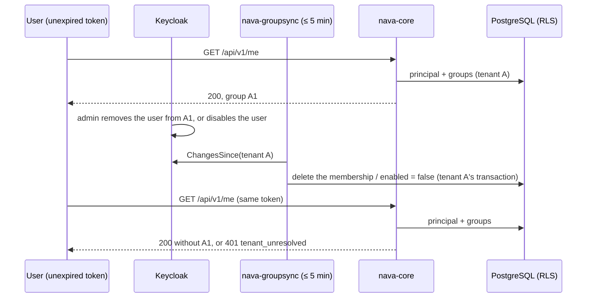

# Deprovisioning and the identity boundary (T26)

PLAN-001 T26 (TICK-82) proves the 10-minute deprovisioning bound (D-P9) and the remaining Epic 03 boundary cases with one named test per case. Each test is registered in the isolation suite (`internal/tenancy/isolation`, case `T26`). The attacker holds a valid token for one tenant, a confidential client's secret, or a self-service login.

| # | Case | Test | Where it runs |
|---|---|---|---|
| 1 | A group removal takes effect within 10 minutes | path `T26-1` (`groupRemovalWithinBound`) | `make isolation` |
| 2 | A disabled user's issued token stops working within 10 minutes | path `T26-2` (`disabledUserWithinBound`) | `make isolation` |
| 3 | Account console and profile self-service cannot change any attribute feeding tenant, role or group | `TestSelfServiceCannotChangeTenantRoleOrGroupAttributes` | `make stack-test-identity` |
| 4 | A service-account token cannot act in any tenant | `TestServiceAccountTokenCannotActInAnyTenant` | `make stack-test-identity` |
| 5 | Token exchange stays disabled | `TestTokenExchangeStaysDisabled` | `make stack-test-identity` |
| 6 | A tenant admin token is refused on `/api/v1/operator/*` | path `T26-6` (`tenantAdminRefusedOnOperatorRoutes`) | `make isolation` |
| 7 | A user cannot self-assign `nava-operator` | `TestUserCannotSelfAssignOperatorRole` | `make stack-test-identity` |
| 8 | An operator token on a tenant endpoint gets 401 | path `T26-8` (`operatorTokenRefusedOnTenantRoutes`) | `make isolation` |

The stack cases are `Stack` paths: the isolation report lists them as `STACK`, and `TestStackPathsExist` (ci-unit) fails if the named test is renamed or deleted.

## The 10-minute bound

The API reads the principal's groups and its `enabled` flag from the synced rows on every request, never from the token (`pgstore.principalSQL`). So once one `nava-groupsync` cycle has applied a change, an unexpired token already sees it. Cases 1 and 2 run the real `groupsync.Syncer` as `nava_groupsync` through PgBouncer and call the real handler with the same token before and after the cycle. They also check both halves of D-P9: `groupsync.DefaultInterval` is at most 5 minutes, and the realm export's `accessTokenLifespan` is at most 300 s. In practice the bound is one sync interval. The token lifespan bounds only what Keycloak itself still accepts.

## Findings

- **Case 8 wording.** The contract says an operator token on a tenant endpoint gets 401 `tenant_unresolved`. The operator token's audience is `nava-operator-api` only, so the adapter refuses it at the audience check: 401 `invalid_token`. A token that also named `nava-api` (a mapper mistake) would pass that check and get 401 `tenant_unresolved`, because an operator has no organization. The test asserts both. Either way the refusal is 401 and names no tenant.
- **Case 6 cannot reach its 403 on this branch.** T21's operator routes are on the S4 story branch (TICK-46), not on S5 (TICK-47). The path asserts what holds here: the operator resolver refuses the tenant admin's token while accepting the allow-listed operator, and the route is not served (404). It fails as soon as `/api/v1/operator/` appears in the contract, so the merge of the two stories must wire `server.WithOperator` into the suite's handler and require 403 (TODO-010).
- **Case 4.** Client-credentials tokens (`nava-platform`, `nava-onboarding`, and any later service-account client, which the test discovers) carry audience `realm-management` and no organization. Keycloak refuses `scope=organization` for them (`invalid_scope`). The adapter refuses them even with a store that binds every organization to tenant B and accepts every principal, without ever looking up a binding.
- **Case 3, at-scale risk (Low, not an isolation gap).** Users created through the admin API, which is how `InviteUser` creates them, and brokered users get `default-roles-nava`, which includes `account/manage-account`. The account API is closed today only because the `account-console` client has no client scopes. With them restored (checked by hand on Keycloak 26.8.1), a user can change their own email to any address without verification, `alice@tenant-b.test` included. Their tenant, roles and groups do not change: the test proves this, and no mapper turns email into a claim. But an address squatted in another tenant's domain makes that tenant's `InviteUser` for it fail as `ErrInviteRefused`, which the API reports as a success. Fix at the lowest layer: make the `email` user-profile attribute admin-edit only (or turn on email verification), and drop `manage-account` from `default-roles-nava` if no one needs the account console.
- **Cases 5 and 7 hold.** No client has `standard.token.exchange.enabled`, and the legacy `TOKEN_EXCHANGE` feature is off. Every client is refused an exchange of a tenant token, for itself, `nava-api`, `nava-operator-api`, or another user. A tenant user and a tenant admin, with nava-web and account-console tokens, cannot map `nava-operator` to themselves through the admin or account API.
