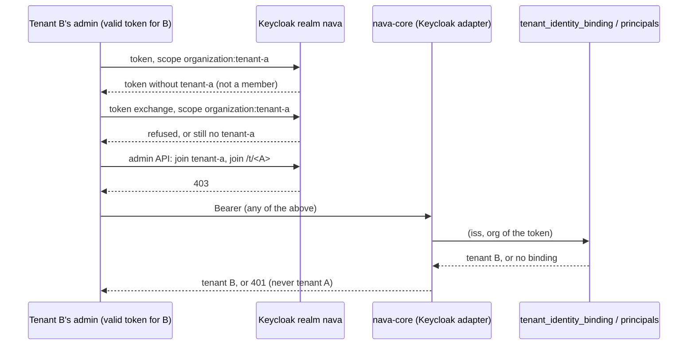
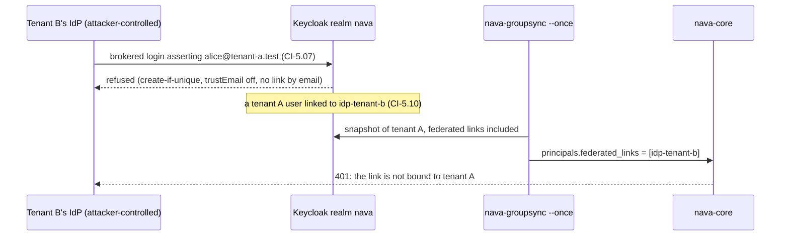

# CI-5: adversarial identity suite (T19)

`make identity-attacks` answers one question on every PR: can someone with a valid login for one tenant, the admin rights of one tenant, or control of one tenant's external IdP get a token the platform accepts for another tenant? It covers ADR-001 Annex B CI-5 (D26, I2) and PLAN-001 T19 (TICK-75).

## Threat model

| Attacker | Holds | Wants |
| --- | --- | --- |
| Tenant user | a valid login in realm `nava` for tenant A | a principal of tenant B |
| Tenant admin | full rights in tenant B, including realm role `tenant-admin` | a token accepted for tenant A |
| Tenant IdP owner | tenant B's external IdP (`idp-tenant-b`), so any assertion it signs | an account of tenant A, or a token accepted for A |
| Token forger | a key of some realm, or a token of another realm or of another type | a token accepted with another issuer |

The tenant comes only from the validated token, through `tenant_identity_binding (issuer, org_id)`. The resolver then checks the token's `idp` claim and the principal's federated links against the IdP aliases bound to that tenant, and refuses anything else (ADR-001 A.1).

## What runs

The suite is `internal/identitystack` `TestCI5`, run against the compose Keycloak with the production `keycloak.Adapter`. It reads bindings and principals through `pgstore` as `nava_app`, from a throwaway platform database built the way a first `docker compose up` builds it. One real group sync (`groupsync.Syncer.Once`, which is what `nava-groupsync --once` runs) fills `principals` from Keycloak. Tenant A is bound to organization `tenant-a` with `idp-tenant-a`. Tenant B is bound to `tenant-b` with no IdP.

The cases are registered in the T15 contract harness (`internal/identity/contracttest`) with `Require: ["CI-5"]`. The run fails if any entry of `contracttest.CI5Cases()` has no case, so a future adapter inherits the whole list. The fake-IdP contract (`internal/identity/keycloak` `TestContract`) tags the token shapes it can mint, without `Require`.

`tools/ci/ci5report` writes `ci5-report.md`. It is meant to be the `ci5-report` CI artifact, but the GitHub step is not added yet: the agent token cannot change the workflow (TODO-011). It has one line per case with its named subtest and result. A case with no subtest, or a subtest that failed or was skipped, fails the run.

| Id | Attack | Must happen | Control in the same case |
| --- | --- | --- | --- |
| CI-5.01 | A user in tenant A's groups, so a principal exists, but in no organization | `ErrTenantUnresolved` | setup asserts the token has no organization |
| CI-5.02 | A member of `tenant-a` and `tenant-b` asks for `organization:*` | `ErrTenantUnresolved` | setup asserts both organizations are in the token |
| CI-5.03 | A Keycloak-signed token of realm `master` | `ErrInvalidToken` | |
| CI-5.04 | Realm `ci5-x`, whose key the test imported, signs alice's claims with `iss` of `nava`. Both realms are trusted. | `ErrInvalidToken`, also on the production adapter | the same key with `iss=ci5-x` verifies (fails only at binding) |
| CI-5.05 | alice's ID token | `ErrInvalidToken` | |
| CI-5.06 | A member of `tenant-a` and a decoy organization posts `kc.org=tenant-b` on the organization picker (TA-B1) | no token naming `tenant-b`; no membership; never tenant B | the picker must be shown, or the case fails |
| CI-5.07 | Tenant B's IdP asserts alice's email and username | no token; alice gains no federated identity | |
| CI-5.08 | Tenant A's IdP asserts an address outside tenant A's domains | no organization in the token; after a sync, `ErrTenantUnresolved` | |
| CI-5.09 | dave, brokered through `idp-tenant-b` and invited, so he is a principal of B; B's binding lists no IdP | `ErrTenantUnresolved` | setup asserts dave is a principal of B |
| CI-5.10 | A tenant A user is linked to `idp-tenant-b`; then one group sync | both the old and a new token: `ErrTenantUnresolved` | before the link, the user resolves to tenant A |
| CI-5.11 | Tenant A invites a user created by a brokered login through `idp-tenant-b` | `ErrInviteRefused`; not in tenant A's group | |
| CI-5.12 | A second binding of `tenant-a`'s `(issuer, org)`, for B and for A, as the superuser | SQLSTATE 23505 | alice still resolves to tenant A |
| CI-5.13 | Tenant B's admin asks for `organization:tenant-a`, exchanges the token, and calls the admin API to join tenant A's organization and group | no token resolves to A; every admin call 401/403; no membership | the admin resolves to tenant B, before and after |
| CI-5.14 | Allowed: carol, brokered through `idp-tenant-a` and invited | token has `tenant-a` and `idp-tenant-a`; resolves to her principal in A with that `idp` | it is the control |

## The negative fixture (CI-5.06)

Keycloak 26.0.0 to 26.1.2 accepted `kc.org` for an organization the user is not a member of, and put that organization in the token (ADR-001 D26, TA-B1). On 26.8.1, CI-5.06 passing could mean that the tamper is refused, or that the case cannot see a tamper at all. `TestKC2612FixtureOrgPickerTamperSucceeds` settles it. It runs the same `orgPicker` flow against Keycloak 26.1.2, the pinned negative fixture in `docs/pins.md`, on a realm shaped like `nava`, and requires the tamper to **succeed** there.

It is opt-in and skipped by default, because it needs its own Keycloak: `make identity-attacks-fixture`. Last run on 2026-10-26: the picker offered `[home decoy]`, and `kc.org=target` gave a token for `target`. On 26.8.1 the same post gives a token with no organization.

## Also registered in the isolation suite

`internal/tenancy/isolation` registers every CI-5 id (`ci5_paths.go`). Some cases run there:

- the token shapes as HTTP paths through the real API handler, which must answer 401: CI-5.01, .02, .03, .09, .10 (seed principal `kc-user-a-foreign`) and .13 (`kc-user-b2`, a principal only of B);
- CI-5.12 as a DB path.

The cases only Keycloak can show are listed as pending on `make identity-attacks`.

## Findings

None. Every case passes on Keycloak 26.8.1. Mutation checks were run while writing the suite. Binding tenant B to `idp-tenant-b` makes CI-5.09 fail. Giving the seed principal of isolation CI-5.10 no link makes that path fail.
