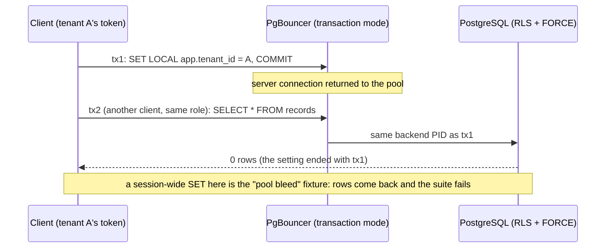

# Tenant isolation suite (T11, CI-2)

`make isolation` answers one question on every PR: can a caller with tenant A's context, or no tenant context, reach a row of tenant B? Code: `internal/tenancy/isolation`. ADR-001 Annex B CI-2; PLAN-001 T11 (TICK-67).

## What runs

A throwaway PostgreSQL gets db-roles and every migration, the same as a first `docker compose up`, with the catalogue gate on. A PgBouncer sits in front of it in transaction mode, with the real `auth_query` and one server connection per role. The suite seeds tenants A and B from `testdata/seed.sql`, then runs three checks.

1. **Generic checks, no registration.** Tenant tables come from `catalog.TenantTables`, the same fail-closed rule as CI-1: every platform-schema table that is not in `db/global-tables.yaml`. Each one is checked as every manifest role, the owner included. Each SELECT, UPDATE and DELETE the role is granted runs in these states, directly and through PgBouncer, and must reach 0 rows or fail:
   - no tenant;
   - an empty `app.tenant_id`;
   - after an earlier transaction did `SET LOCAL` of tenant A. Through PgBouncer, that earlier transaction ran on another client's session, and the suite asserts the same backend PID.

   Then, with tenant A set through `tenancy.InTenantTx`, the same statements must reach no row whose tenant key is not A.
2. **Registered paths** (`registry.go`): named SQL, HTTP and in-process cases. Each is tagged with its ADR test id and run as tenant A against tenant B's data.
   CI-9 (T12, TICK-71) adds `DB` paths (`role_paths.go`), one per system-actor bullet. Each drives the database through `Cluster` (a role's pool, and the superuser for seeding), proves a positive control first, and removes what it seeded:
   - `nava_relay` gets 42501 on `records` by name, count, join and `EXISTS`, with and without a tenant set; it still reads `outbox`.
   - `nava_purge` gets rows past and inside each window, for both tenants. It sees exactly the expired keys, gets 42501 on every data column, and `purge.Purger.Once` deletes exactly the expired rows.
   - `nava_onboard` activates a provisioning tenant P (the control). It reaches 0 rows of an active tenant (A from A, B from A, A from P), and cannot insert one.
   - `nava_onboard` binds P (the control), but cannot bind P once activated, or A or B.
   - `nava_onboard` cannot move A, or P once activated in the same transaction, back to `provisioning`.
   - `nava_backup` runs T08's `pg_hba` cases (`internal/db/hba.BackupCases`, which `db/pg_hba_test.go` runs too) on the embedded `db/pg_hba.conf`, and gets 42501 connecting to `nava` (no CONNECT, under the `pg_hba` reject). `make stack-test-hba` proves the reject on the running stack.
3. **Fixtures.** Each one breaks a single control and must turn a PASS line into a FAIL:
   - `NO FORCE` on `records`, which the owner line catches;
   - RLS disabled on `outbox`;
   - a fail-open policy;
   - a session-wide `SET` through PgBouncer.

   CI-9 has its own fixtures (`TestCI9FixturesMakePathsFail`). Each widens one role's grant or policy and must turn its path from PASS to FAIL: a `records` column granted to the relay; a data column granted to purge; a purge SELECT policy that stops testing expiry; a purge DELETE policy that matches nothing; `tenants_activate` without its state test, or with any target state; `binding_onboard` open to any tenant; CONNECT granted to `nava_backup`. `internal/db/hba`'s unit test edits `pg_hba.conf` five ways, and each edit must fail the `nava_backup` cases.

The report goes to `isolation-report.md`, which CI keeps as the `isolation-report` artifact. It has one line per role × table, grouped by ADR test id, with each id's coverage note, so CI-8 and CI-10 show as partial. CI-9 lists its fixtures under its paths.

## Fail-closed rules

- A tenant table with no seed rows for both tenants fails, because 0 rows from an empty table proves nothing. A migration that adds a tenant table also adds its rows to `seed.sql`.
- A role that may touch rows of a table but cannot read its tenant key fails, because "other tenants' rows" cannot be expressed for it.
- Cross-tenant reach is accepted only through `Exemptions()`, and only for an A.3 allow-listed policy whose `USING` is `true` (`TestExemptionsAreAllowListed`). Today those are `outbox_relay_select`, `outbox_relay_update` and `binding_lookup`. The purge policies are not exempt: the seed has no expired rows, so a purge policy that stops testing expiry fails.
- An HTTP path must stay `Pending` until the HTTP runner exists (T17). A non-pending HTTP path fails.
- Pending paths use no `t.Skip`. The skip guard in `docs/delivery/review-paths.yaml` stays meaningful.

## Registering a path (later epics)

Add a `Path` to `Paths()` with `Case` set to its ADR id. SQL paths run as `Role` inside `InTenantTx(TenantA)` and are rolled back. Pick one of two expectations:

- `OwnRowsOnly`: every row's first column is tenant A.
- `Denied`: an error or 0 rows. Aim UPDATE and DELETE where an integrity error cannot hide a reached row.

Editing `registry.go` needs CTO sign-off (D-P10).

## Not covered here (owner)

- Forged tenant in the payload, a header or the query, over HTTP. Registered as pending, waiting on T17 (TICK-72).
- Byte-identical 404, `If-Match` 412 and the masked-field filter: CI-8 rest, TICK-87.
- Write cascades: CI-10, TICK-88.
- Generic INSERT probes. `WITH CHECK` is covered by the registered insert paths for every table a runtime role may insert into.
