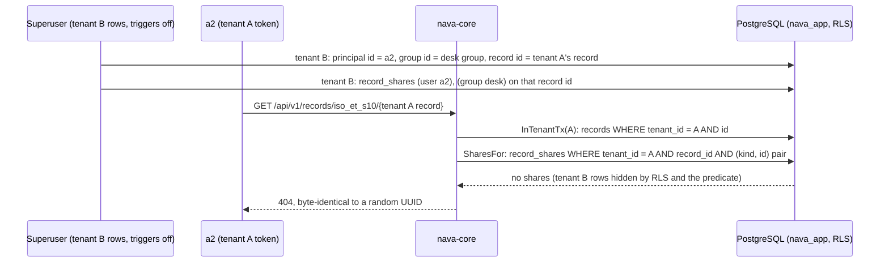

# S10 record ACL and field masks: attack rows (P3-37)

TICK-622, story TICK-336 (S10). The attacker holds a valid token for one tenant, or is a user of the right tenant whom the ACL does not admit, and tries to reach a record, a field or an id they should not see. Each attack is a registered isolation path (`internal/tenancy/isolation/acl_attack_paths.go`, ADR test id CI-8). It runs the real nava-core handler over the suite's database as `nava_app` through PgBouncer, and `make isolation` reports it as a PASS/FAIL row in `isolation-report.md`.

## Fixture

Every row builds the fixture fresh (`s10Setup`) and deletes it afterwards.

- **Tenant A's type `iso_et_s10`.** Its policy is published past the PUT route's validation. Rules:
  - `admins`: read and write, for tenant A's admins group (a1).
  - `desk`: read and write, for the auditors group (a2), where `assignment_group_id` is in `my_groups`.
  - `requester`: read.
  - `shared`: read.
  - `foreign`: read and write, naming tenant B's groups and users.
- **Masks.**
  - `cost` and `assignee`: admins only.
  - `triage`: a2 only, so the admin cannot read it.
- **Tenant B's own `iso_et_s10`.** Tenant B's requests get past the type lookup and reach the record lookup.
- **Records.**
  - A desk record at version 2 (the patch to version 2 changed `cost` only).
  - An admin-group record.
  - Tenant B's own record.

## Rows

| Row | Attack | Defence | Mutation shown red (PR) |
|---|---|---|---|
| CI-8 (d) | The desk filters on masked `cost` | `checkPlan` (`authz.CheckQueryFields`) before any SQL | `checkPlan` returns nil: 200 |
| 1 | Tenant B's members of the groups that tenant A's `foreign` rule names: GET, PATCH (none, stale and current `If-Match`), history and list of tenant A's records | Tenant from the token; RLS and the `tenant_id` predicate on the record lookup; the policy is per tenant | `recordSelect` by id only, with RLS off on `records` and `entity_definitions`: 200 with tenant A's record |
| 2 | A record the caller cannot read (plain user, or the desk on the admin record): GET, history, PATCH with no, a stale and the current `If-Match` | `canRead` maps `ErrNotVisible` to the missing-record 404, before `If-Match` | `canRead` answers 403: the oracle check fails |
| 3 | Filter (`eq`, `in`, combined), sort (asc and desc) and `total` on masked `cost` and `assignee`, for a value that matches and one that does not | `checkPlan` before any SQL; the 400 carries no page or total | Same as (d): the desk's `filter[cost]=600` returns the matching record |
| 4 | History of a record whose patch changed only `cost` | `authz.Shape` on `before` and `after`; `changed` is computed after shaping | No shaping: `cost` appears in `after` |
| 5 | Explainer: tenant B's record or user, tenant B's admin on tenant A's ids, a non-admin, and a field the admin cannot read | `InTenantTx` and `PrincipalOf` in the caller's tenant; `RequireTenantAdminTx` first; `Explain` lists only fields `Readable` by the admin | The `Readable` filter dropped: `masked_fields` names `triage` |
| 6 | The desk PATCHes its record into the admins group, or creates one there | `CanWrite` checks `Allows(write)` on `before` **and** `after` (A1) | The after-state check skipped on update: 200 |
| 7 | Share forgery: tenant B gets a principal with a2's id, a group with the desk group's id, and a record with tenant A's record id, and shares it in tenant B | `record_shares` RLS; `SharesFor` and the `CompileRead` `EXISTS` match `tenant_id` and the `(kind, id)` pair | Tenant predicate dropped in both, with RLS off on `record_shares`: 200 |
| 8 | PUT access with tenant B's group or user in a mask's `read`, `write` or `users` | `authz.NotInTenant` on every subject id, the same 422 for a foreign and an unknown id | `NotInTenant` given no refs: 200, version 3 published |

Row 7 needs both layers removed to go red. With only the predicate dropped, RLS still hides tenant B's shares and the row passes. That is defence in depth.

A foreign group in a mask's `write` that is not also in its `read` is refused as `mask_write` (write must be within read) before the tenant check runs. That answer is still identical to an unknown id's, and nothing is written.

## Share forgery (row 7)

## Not covered here

- **Timing.** The masked-field gate runs before any SQL (`records_list.go`), so no query runs whose duration could depend on the value. The suite does not measure time.
- **Count and aggregate routes.** M1 has none; `total` on the list is the only count, and row 3 covers it.
- **The explainer does not check that the admin can read the target record.** This is a recorded Low finding from the PR #531 review. Trigger to revisit: any non-admin role gets access to the explainer.
