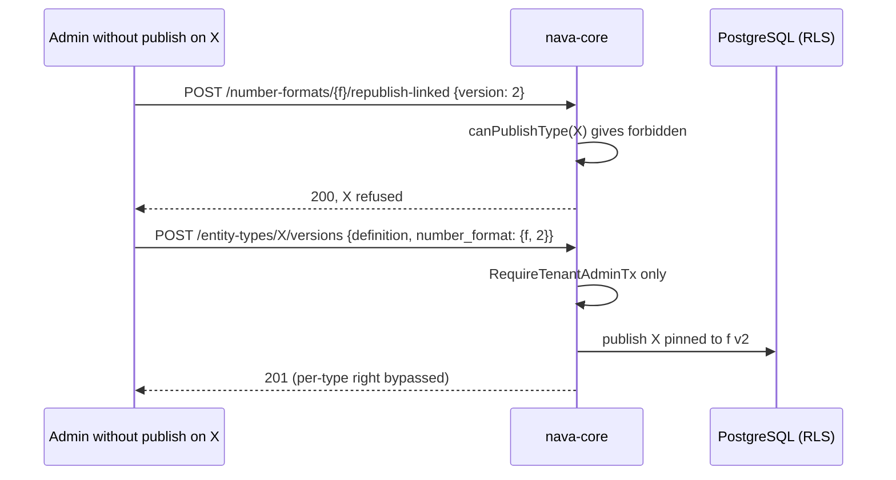

# S18 number formats, links and epochs: attack rows (P6-11)

TICK-676, story TICK-669 (S18). Design: ADR-005 §3.3, §3.7 C8-C13 and §5. The attacker holds a valid token for one tenant, or is a tenant admin of the right tenant without the definition-publish right on one entity type. Each attack is an integration test in `internal/server/numberformats_attack_integration_test.go`. It runs the real nava-core handler over a throwaway PostgreSQL as `nava_app`, through `scripts/ci/test-integration.sh`.

The earlier guards stay in force: `numberformats_isolation_integration_test.go` (TICK-672) and the link and race tests in `numberformats_link_integration_test.go` (TICK-673). This suite adds the rows below.

## Rows

| # | Attack | Defence | Test |
|---|---|---|---|
| 1 | Tenant B's admin aims every format route at tenant A's format id: GET, GET `?version=1` and `?version=2`, PUT with a current, a stale and no `If-Match`, PUT with a bad body, re-publish to v2 and v9, and a link into B's own type at v1 and v2. B compares status, body, headers and `ETag` with the answers for a made-up id. | The tenant comes from the token. RLS covers `number_formats` and `number_format_versions`. The format lookup runs before `If-Match` and before the body. The link uses a composite FK led by `tenant_id` (C8). | `TestNumberFormatAttackForeignIDEveryRouteIsTheMissingAnswer` |
| 1t | The same comparison by timing class: the medians of 25 interleaved GETs. | Both ids take one tenant transaction and one SELECT that RLS leaves empty. | `TestNumberFormatAttackForeignIDTimingClassIsTheMissingOne` |
| 1k | By key: B reads A's key in the id slot, creates a format with A's key, and lists its own formats. | `UNIQUE (tenant_id, key)` (C9), so the create is a 201 and not a 409. The list runs under RLS. | `TestNumberFormatAttackForeignKeyIsNoOracle` |
| 1c | B replays the `next_cursor` from A's list. | The cursor claims bind the cursor to the caller. The replay gets `400 invalid_cursor`. | `TestNumberFormatAttackForeignCursorIsRefused` |
| 2 | Every create, publish, link and re-publish body forges `tenant_id`, `id`, `version`, `current_version`, `source`, `source_ref`, the actor fields, `created_by` and `published_by`. It also carries a forged `compiled` form claiming epoch 0, which would skip the M3 gate and the disjointness check. | Every body is parsed into known fields only. The server compiles the document. Any extra member inside `number_format` is a 422. The audit actor comes from the principal, with `source = user` and no `source_ref` (C12). | `TestNumberFormatAttackForgedFieldsInEveryFormatBody` |
| 3 | A caller without the publish right on type X calls "re-publish linked types". | `canPublishType` is checked for each type in the type's own transaction (C13). X is refused as `forbidden` and the other types are still published. | `TestNumberFormatAttackRepublishRefusesPerType` |
| 3d | The same caller links, bumps or unpins X through `POST /entity-types/X/versions`. | **Gap F1**: this route checks only the tenant-admin right and never calls `canPublishType`. | `TestNumberFormatAttackDirectLinkRefusesPerType` (skipped, TODO-S18-01) |
| 4 | Ten link publishes race on one type. They use five templates with two format ids each, and two of the templates clash. | The epoch is taken under the type's `FOR UPDATE`, and the registry has its UNIQUE constraints (C10). The test checks: no 500, one epoch row per template, and every pin names the registry's epoch for its template. | `TestNumberFormatAttackLinkRaceNeverForksAnEpoch` |
| 5 | Two accepted epochs of one type that render one string. The variants change only what the literal head does not see: overflow, seq width, date parts, the format's time zone, a digit after `{prefix}`, or the default head with `refuse` or a date. A tenant time-zone change also falls between two links of the same template. | `DisjointHeads` is checked against every epoch, epoch 0 included. The time zone is not part of the template hash, so the same template keeps its epoch and its counters. | `TestNumberFormatAttackNoTwoEpochsRenderOneString` |

Rendering a number from a linked format through the record API arrives with TICK-674 (P6-09). Row 5 proves the precondition at publish time: no two accepted epochs of a type can share a rendering.

## Guard removed, test red (shown on the PR)

- With `takeEpoch`'s epoch-0 head check disabled, row 5 fails. `{prefix}{yy}{seq:5}` is accepted as a second epoch with head `VISA`, the same head as the default numbers.
- With the `t.Skip` removed, row 3d fails today: the direct link of a denied type answers 201.

## Finding F1: the direct publish route bypasses the per-type seam

- **Status:** will bite at scale. Today the seam's production value is `RequireTenantAdminTx`, the same check, so nothing can be exploited.
- **Severity:** Medium. It stays inside one tenant, and it changes how type X is numbered.
- **Fix:** `PublishEntityTypeVersion` calls `h.canPublishType(ctx, tx, p, req.Key)`, for a mode-only change too. The fix must land with or before any per-type publish right, which is the same trigger as AR-S18-01 and TICK-859.
