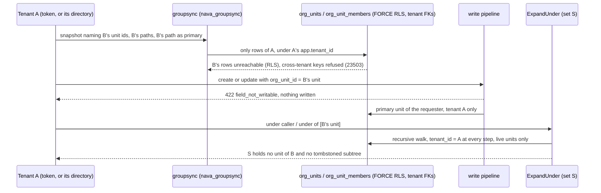

# S31 org units: isolation review and attack tests (P11-19)

TICK-952, story TICK-946 (S31), ADR-010 I1, I3, D7, D8. The attacker holds a valid token for tenant A, or controls tenant A's Keycloak directory (its groups and the `nava_primary_org_unit` user attribute). They try to see or write tenant B's org-unit rows, to give a record of A a unit of B, or to widen `under` access after a directory change. Every attack below is a runnable `//go:build integration` test, and the passing ones stay as regression guards.

**Verdict: no exploitable isolation gap.** Every guard holds at the database (FORCE RLS, grants, foreign keys that carry `tenant_id`). The `under` set-S query and the primary-unit lookup filter by tenant on top of RLS. The reviewer's verdict on TICK-947, TICK-948 and TICK-949 is in the PR description of this change.

## Paths to data

| Path | Tenant comes from | Lowest-layer guard |
| --- | --- | --- |
| `org_unit_members` reads (`nava_app`, `nava_worker`, `nava_groupsync`) | `app.tenant_id`, set by `InTenantTx` from the token or the sync's tenant | FORCE RLS on SELECT. Only `nava_groupsync` may write, through RLS `WITH CHECK` |
| `org_units` writes (`nava_groupsync`) | the sync's tenant | FORCE RLS. There is no DELETE grant or policy. The parent FK is `(tenant_id, parent_id)` |
| `records.org_unit_id` on create (`pipeline.resolveUnit`, `store.PrimaryUnit`) | the write transaction's tenant | `primaryUnitSQL` filters `m.tenant_id`, RLS, and the FK `(tenant_id, org_unit_id)` |
| `records.org_unit_id` from a body (API, workflow `update_record`) | n/a | `refuseOrgUnit`, `field_not_writable` on create and update, for every source |
| Set S (`authz.ExpandUnder`, `expandSQL`) | `tenancy.TenantOf(tx)` | every step of the recursive query filters `tenant_id = $1`. `scopeFor` drops a binding made for another tenant or principal |
| The 10,000 cap (`UnderSetTooLargeError`) | n/a | the error carries the entity type only |

## Attack table

| # | Attack | Result | Test |
| --- | --- | --- | --- |
| 1 | Read, add, move or drop tenant B's `org_unit_members` rows as `nava_app`, `nava_worker` or `nava_groupsync`, with B's predicate or none | Each role reads only A's rows. Every write is refused (42501 by grant or RLS, or 23503 by the tenant FK), or reaches 0 rows | `internal/tenancy/isolation/registry.go` (`org_unit_members:` paths, TICK-947 and TICK-952) |
| 2 | Give a record of A a unit of B: in the body (create, update, workflow `update_record`), or through a forged primary membership that the pipeline's lookup reads | The body is refused with `field_not_writable` for every source. The forged lookup fails closed: FK 23503, nothing written. No record of A names B's unit | `internal/records/pipeline/org_unit_isolation_integration_test.go` `TestRecordNeverGetsAnotherTenantsOrgUnit`; `org_unit_integration_test.go` `TestOrgUnitNeverReadsAnotherTenantsMembership`, `TestCreateRefusesOrgUnitInBody`; `internal/db/dbtest/org_units_test.go` `TestTICK947RecordOrgUnitIsTenantScoped` |
| 3 | A tombstoned unit grants through `under`, including to a member whose row was not removed | The live FK refuses a member of a tombstoned unit, and refuses tombstoning a unit that still has a member, for every role (23503). groupsync deletes members before the tombstone, in one transaction. A forged member row in a tombstoned unit adds nothing to S, and neither does its live subtree | `TestUnderSetIgnoresForgedCrossTenantAndTombstonedRows`; `TestTICK947MembershipConstraints`; `acl_under_integration_test.go` `TestUnderSetFromARealTreeAgreesInSQLAndGo` |
| 4 | Set S contains a unit of B: a forged membership of an A principal in B's unit, B's unit hung under A's tree, A's unit hung under B's, `under of [B's unit]`, or S bound in A and evaluated for a principal that claims B | S never holds a unit of B (SQL, Go and branch split agree). A binding made for another tenant voids the policy, `not under` included | `TestUnderSetIgnoresForgedCrossTenantAndTombstonedRows`, `TestUnderSetBoundInOneTenantGrantsNothingToAnother` |
| 5 | groupsync deletes an org unit. A crafted directory payload with B's Keycloak ids or paths un-tombstones, renames or reparents B's unit | No DELETE grant (42501). B's tombstoned unit keeps its `deleted_at`, and B's live unit, members and rows are unchanged. A gets units of its own, never on B's ids | `internal/groupsync/orgunit_isolation_integration_test.go` `TestDirectoryPayloadNeverUntombstonesAnotherTenantsUnit`; registry `org_units:` paths; `TestTICK947GroupsyncCannotDeleteOrgUnits` |
| 6 | The 10,000 cap error leaks unit ids | The error, reached through the caller seed or a listed root, contains no UUID. The HTTP body is the fixed `access_scope_too_large` problem | `TestUnderCapErrorNamesNoID`; `internal/server/entitytypes_test.go` `TestUnderSetTooLargeIsAccessScopeTooLarge` |
| 7 | `nava_primary_org_unit` names a group path that exists only in B | When the user is in no A unit, or in two, no primary is set, and the pipeline's lookup returns NULL, so a new ticket's `org_unit_id` stays NULL. B's own primary is unchanged. (When the user is in exactly one A unit, D-11-6 falls back to that A unit, which is the user's own unit) | `TestPrimaryOrgUnitPathOnlyInAnotherTenantSetsNoPrimary`; `orgmembers_isolation_integration_test.go` `TestPrimaryOrgUnitNeverResolvesAcrossTenants` |

The forged rows in attacks 2 to 4 are written by the superuser with `session_replication_role = replica`, which skips every FK and trigger. That attacker is stronger than the owner role: the owner is held by FORCE RLS and cannot disable the RI triggers. These tests therefore show that set S and the lookup do not depend on the FKs alone.

## Cross-references

- **TICK-1029 (attack 4).** `scopeFor` matches a binding on tenant and principal id. Attack 4's cross-tenant binding test shows that the tenant half holds. TICK-1029 adds the groups to the binding, so that a principal with the same id but other groups cannot reuse S. That is a same-tenant gap with no call site today, and the fix is left to TICK-1029. Attack 7 does not touch the binding.
- **R3 (revocation window).** A user moved out of a unit keeps `under` access until the next sync. This is accepted as [AR-TICK-901-01](accepted-risks.md) (ADR-010 R3).

## Recorded, not blocking

- `primaryUnitSQL` does not join `org_units` to check that the unit is live. It relies on the live FK of `org_unit_members`. Only a forged row can name a tombstoned unit, and `under` excludes tombstoned units anyway, so this grants nothing. Recorded as AR-S31-01.
