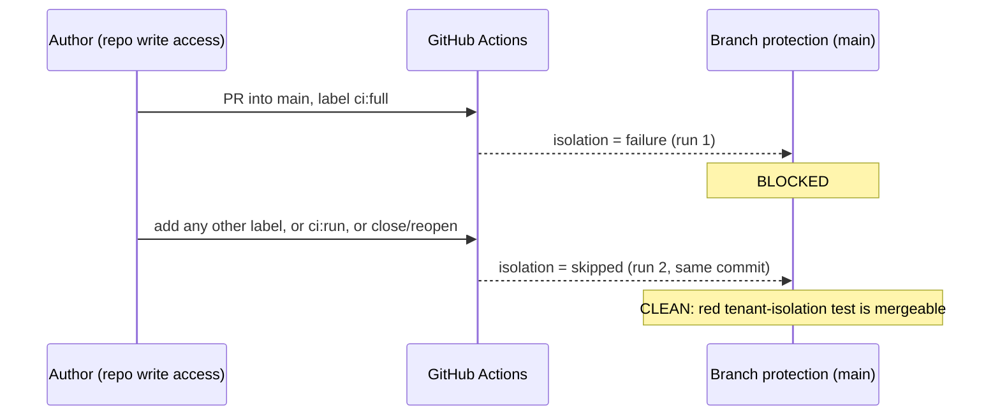

# S6: a skipped run hides a red required check

Finding S6 (TICK-1140), proven on TICK-1146 (spike PR #898). GitHub takes each
required check from the newest check run of that name on the head commit. A
skipped job still reports its name, and skipped counts as passed. So a later
run in which `isolation` is skipped turns an earlier red `isolation` into a
mergeable `CLEAN` pull request.

Who can do it: anyone who can label a pull request. No token or tenant
privilege is needed; the effect is that a tenant-isolation regression reaches
`main` and is caught only by the daily full run (up to about 24 hours).

## Fix

- `isolation`: PR #902 (merged 2026-11-26) names the job
  `${{ github.event_name && 'isolation' || 'isolation' }}` (a skipped job
  reports the raw expression, so only a run that executed it can satisfy the
  required name; a constant `${{ 'isolation' }}` is folded to the literal even
  when skipped, verification PR #904) and runs it on every labelled run. Pinned by the `checks:`
  list in `tools/ci/cisteps/required.yaml` (`make check-ci-steps`).
- Other required jobs: ADR-001-E4 (PR #895, TICK-1140).
- Until both land: mergers list the check runs on the head commit with
  `filter=all`, drop the skipped ones, and refuse if any required job's last
  executed result is not a success.

## Historical scan (2026-11-26)

Did any merge into `main` since TICK-652 rely on a hidden red? Script and raw
output: [`s6-scan/`](s6-scan/). For each of the 118 pull requests merged into
`main` from 2026-11-09 (TICK-652 merged 2026-11-10), it read every check run on
the merged head commit (`filter=all`), ordered each name's runs by completion,
and flagged any name whose last executed (non-skipped) result was not a
success. That covers case b (label-only run after the red), case d (`ci:run`
after `ci:full`) and case e (a label run that finished before the red one).

| Result | Count |
|---|---|
| Merged PRs scanned | 118 |
| `isolation` executed and green (last executed = success) | 11 |
| `isolation` never executed (fast run; AR-TICK-652-01) | 27 |
| No `isolation` check (merged before the job existed, PR #780, 2026-11-20; the suite ran inside other jobs, covered by the all-names check) | 79 |
| `isolation` last executed = cancelled | 1 (PR #866: cancelled at 0 s by concurrency before it started; the next run skipped it as a fast run) |
| Any required job whose last executed result was `failure` or `timed_out` | **0** |
| Executed failures followed by a later executed success on the same commit | 5 (re-runs, not hidden) |

Every other non-success last result was a `cancelled` of 0 s (a concurrency
cancel before the job started) on `main-red`, `full-suite`,
`self-hosted-cleanup`, `temporal-server`, `sdk` or `stack`. None of them ran a
test. Conclusion: no past merge into `main` relied on a hidden red check; 27
merges into `main` never ran the isolation suite at all, which is the accepted
risk AR-TICK-652-01, not S6.
