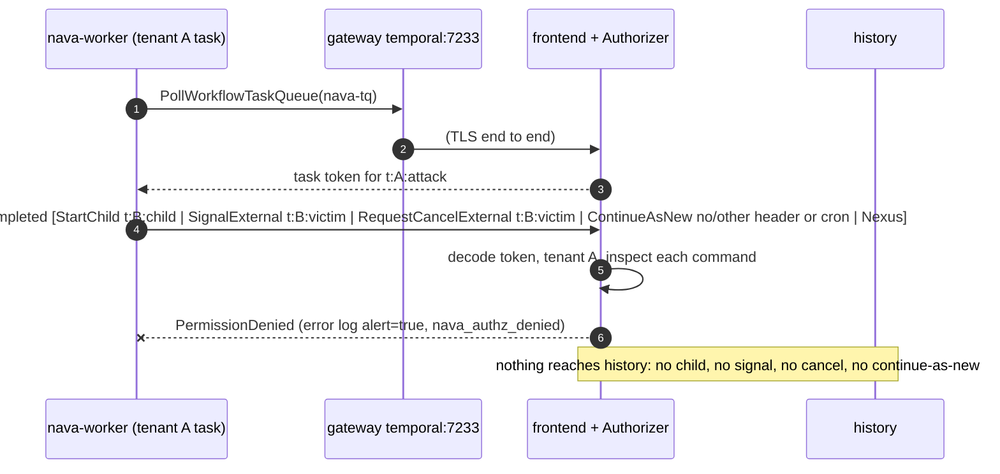
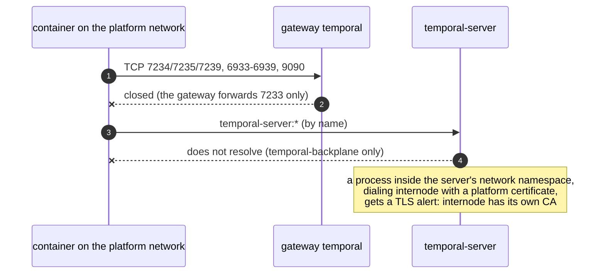

## CI-6 first block: certificate, network and Authorizer (T32a)

The live adversarial suite for the custom Temporal server. It runs against the
compose Temporal over mTLS, through the gateway, with the real Authorizer. Nothing
is stubbed. Source of the rules: ADR-001 Annex B CI-6 and Annex A.2, erratum E1
(TICK-83), and the D9 workload allow-list (ADR-001-A1).

- Tests: `internal/temporalstack/ci6_isolation_test.go` (helpers in
  `ci6_helpers_test.go`). Every test is named `TestCI6_*`. The file name matches
  the `**/*isolation*_test.go` pattern in `docs/delivery/review-paths.yaml`, so
  removing it, or adding a skip to it, needs CTO sign-off.
- Run: `make stack-up`, then `make stack-test-sdk`. To run a second stack on the same host, set `COMPOSE_PROJECT_NAME` and the port variables, then point the tests at it with `NAVA_TEST_COMPOSE_PROJECT` and `NAVA_TEST_TEMPORAL_ADDR`. This writes the report
  (`ci6-report.md`) through `tools/ci/ci6report`. The CI `stack` job already runs
  this step. Uploading the report as the `ci6-report` artifact needs a change to
  `.github/workflows/ci.yml`, which is attached to TICK-79 because the agent token
  cannot push workflow files. The step fails if a contract case fails, is skipped or is
  missing.
- Last local report: [`ci6-report.md`](ci6-report.md).

### Threat model

The attacker is a platform process that holds one valid certificate: `nava-relay`,
`nava-core`, `nava-worker` or `nava-operator`. Or it holds a certificate it should
not have: one from another CA, or one from the installation CA whose CN is not an
identity. The attacker wants to reach another tenant's workflows (`t:B:*` from a
`t:A:*` task), an API outside its row, or the server's internal ports.





### Cases and how each is proven

| Case | Proof |
|---|---|
| Rogue CA | A `nava-relay` certificate signed by a fresh CA, and no certificate at all, each get a TLS alert from the server. The real `nava-relay` certificate gets none (control). |
| Unlisted CN | `nava-unknown`, from the installation CA (`make dev-ca` writes it and nothing mounts it), passes the handshake. Every call is then `PermissionDenied`. The log has a `reason=no_identity` line for each call, after this run's anchor (a deny that carries a unique namespace). `nava_authz_denied{identity=none,reason=no_identity}` rises by at least 5, and the denied start's workflow id is `NotFound`. |
| Internal ports | One container on `internal` gets OPEN for `temporal:7233` (control) and CLOSED for every internode, membership and metrics port, on `temporal` and on `temporal-server`. |
| Internode handshake | Run inside the server's network namespace. History (7234) and matching (7235) serve the internode certificate (control) and refuse all five platform certificates. 7239 has no listener at v1.29.7. |
| Allow-list sweep | For `nava-relay`, `nava-core`, `nava-worker` and `nava-operator`, every unary method in `temporal-server/authz/testdata/allowlist.golden.md` that is not on the identity's row is `PermissionDenied`. Each request carries namespace `nava`, so it reaches the Authorizer. Real requests aimed at a running tenant-B workflow leave it RUNNING and unsignaled. |
| Operator pinned list | `ReapplyEvents`, `ImportWorkflowExecution`, `DeleteWorkflowExecution` (admin and workflow service) and `DeleteNamespace` are each aimed at a real victim and at `nava`. Each is denied, with an `api_not_allowed` log line after this run's anchor, and `nava_authz_denied` rises by at least 5. The victim and the namespace survive. |
| Worker commands (E1) | A raw `nava-worker` poll takes the task of a fresh `t:A:` workflow and answers it with the attack command. The test requires `PermissionDenied`, an `alert=true` error log line (certificate, workflow id, command, reason), a rise in `nava_authz_denied{identity,reason,command}`, and no `WorkflowTaskCompleted` in the attacker's history: a denied response never reaches history, whatever the command. The cross-tenant tests also check the victim's history. |
| Token | An undecodable token is denied with `task_token_invalid`. A real task of an unprefixed workflow id (started by `temporal-system`, which is exempt) is denied with `workflow_id_no_tenant`, under the same four checks as the worker commands. |
| Allowed | A real SDK worker, whose propagator adds `nava-tenant`, runs a parent that starts a same-tenant child, and both complete. Each SDK identity dials and its worker starts. |

A mutation check was run by hand. With the child target switched to the
attacker's own tenant, the cross-tenant child test fails: the call is allowed and
no alert is logged. So the deny depends on the tenant, not only on the command
type.

### Observations (none exploitable)

1. **The undecodable-token deny alerts in the log but would not page.** Status:
   will bite us at scale. Severity: Low. A `task_token_invalid` or
   `request_malformed` deny carries `command="none"`. The two rules in
   `docs/temporal-server.md` page on `command!="none"`, or on a list of D9
   reasons that leaves both out, so neither rule fires on these denies. The rules
   are not installed yet (TODO-004). Fix: add `task_token_invalid|request_malformed`
   to the reason list of the second rule when TODO-004 installs them.
2. **Prometheus rewrites label values.** Severity: Low. The server's reporter
   replaces every character outside `[A-Za-z0-9_]`, so the series reads
   `identity="nava_worker"` and `api="_temporal_api_workflowservice_v1_WorkflowService_..."`.
   A rule that filters on `identity="nava-worker"` would never match. The
   documented rules do not filter on identity or api today. Whoever writes them
   under TODO-004 should use the rewritten values.
3. **For a few calls, the namespace check runs before the Authorizer.** Severity:
   none. A call to a task-token API with no namespace and no token gets
   `InvalidArgument` ("Task token not set") instead of `PermissionDenied`. The
   answer depends only on the shape of the request and reveals no tenant data.

## CI-6 relay and worker cases, and CI-7 (T32b)

The second CI-6 block and every CI-7 case. Source: ADR-001 Annex B CI-6 "Other
cases", CI-7 and R1, A.2, and the TICK-93 audit (headers). The relay under test
is the stack's own `nava-relay` service. The test writes outbox rows the way
`outbox.Enqueue` does, as the superuser inside the postgres container, because
the database port is never published. The service claims the rows as
`nava_relay` and dispatches them with its own certificate. A worker set up with
`workerguard` runs the workflow `nava.smoke.relay`. This is the D9 allow-list's
first lowercase type, the only form an outbox kind can name. The
`workflow_ref` activity runs in the `nava-worker` service.

- Tests: `internal/temporalstack/ci6_relay_isolation_test.go` (`TestCI6_*`) and
  `ci7_isolation_test.go` (`TestCI7_*`), with helpers in
  `ci6_relay_helpers_test.go`. `make stack-test-sdk` runs them, and
  `tools/ci/ci6report` lists each one in the report with its tag.

```mermaid
sequenceDiagram
    autonumber
    participant X as attacker holding the nava-relay certificate
    participant DB as outbox (PostgreSQL)
    participant R as nava-relay (1..3 processes)
    participant T as Temporal + Authorizer
    participant W as guarded worker
    X->>T: Start t:A:nava.smoke.relay:… with no header / with tenant B's header
    T->>W: workflow task
    W--xT: workflow FAILED nava.TenantGuard (alert)
    X->>T: Signal t:A:… with tenant B's header ("done")
    T->>W: signal
    W-->>W: dropped (alert); the workflow keeps running
    DB->>R: rows claimed head first (target_seq), leased
    R->>T: start / signal, header = row tenant
    Note over R,T: redelivered start → AlreadyStarted, no second run<br/>redelivered signal → applied once (outbox id), across continue-as-new<br/>signal on a missing or closed target → NotFound → dead, alert, never retried
```

| Case | Proof |
|---|---|
| No or mismatched header fails the workflow | A `nava-relay` client with no propagator, and one that puts another tenant on the header, each start `t:A:…`. The Authorizer lets both through. Each workflow ends FAILED with `nava.TenantGuard` `workflow_start: missing` or `mismatch`, and the guard logs one alert. |
| Wrong-tenant signal dropped | A note and a `done` with tenant B's header reach tenant A's relay-started workflow. Both signals log alerts and are dropped, and the workflow stays RUNNING. A note and a `done` written to the outbox afterwards return only the own note. |
| Redelivered start after completion | A start and `done` are written and the workflow completes, with `workflow_ref.closed_at` set by `nava_worker`. The start row is then made pending again. It is dispatched at attempt 2 (AlreadyStarted), and the latest run is still the completed one. |
| Redelivered signal applied once | One note is delivered three times: before continue-as-new, again before it, and again after it. A second note follows. The result is the two notes, each once. |
| Signal queues behind its start | The start, a note and `done` are written in one transaction, with the start held 15 s. For 3 s (six polls) no row is attempted. Afterwards every row is dispatched at its first attempt, in the order start, note, done. |
| Two relays never reorder | Two more `nava-relay` containers run beside the stack's: same image, environment, certificate and network. The hand-off is forced with `docker pause`. Extra relay 0 alone dispatches each of three targets' start and first 8 notes. Extra relay 1 alone dispatches the next 7. Then all three relays run for `done`. Each phase waits until its rows are settled, so a paused relay holds no lease, and a cleanup unpauses every relay. Each target applies its 15 notes in exact `target_seq` order. Both extra relays have `outbox_relay_dispatches_total{op="signal",outcome="dispatched"}` above zero. |
| `NotFound` on a signal is terminal | A signal to a start that was never dispatched, and a signal to a completed workflow. Each is dead at attempt 1 with `CauseTargetMissing` and unchanged after four more polls. The relay logs the workflow id, and `outbox_relay_signal_target_missing_total` rises. |
| CI-7 producer schema | `outbox.ValidatePayload` rejects text, numbers, booleans, nested objects, mixed arrays, a text field next to a reference, and anything that is not an object. |
| CI-7 history input | The `outbox.Delivery` Go type has only UUID, int16 and payload fields. The recorded start and signal inputs of a relay-started workflow have only its JSON keys, and each payload passes the producer schema. |
| CI-7 payload outside `Enqueue` | Added by TICK-214 with its fix (finding T32b-1). A start row with record data, inserted directly as the superuser, is refused by `outbox_payload_references_check`; no row is stored and no workflow exists. |
| CI-7 activity payload | Not in this PR. The test lands with its fix in TICK-216 (finding T32b-2). |
| CI-7 headers (TICK-93) | Every `Header` anywhere in both runs' histories is walked: start, signals, activity, continue-as-new. The keys are only `nava-tenant` and `_tracer-data`, and `_tracer-data` holds only `traceparent` and `tracestate`. A signal sent with baggage in its context leaves no trace of it. |

### Findings (T32b)

1. **T32b-1: a record-data payload written outside `Enqueue` reaches the
   history.**
   - **Attack:** code running as `nava_app` or `nava_worker` inserts an outbox
     row whose payload holds record data, for example a feature that bypasses
     `Enqueue`, or an injection. `db/grants.yaml` lets both roles INSERT every
     outbox column. The relay dispatches the payload unchecked, so the record
     data lands in the cross-tenant, unencrypted Temporal history (R1). No
     endpoint writes outbox rows today, so a tenant token cannot trigger it.
   - **Status:** values fixed by TICK-214; keys open (follow-up TICK-240)
     (`db/migrations/00006_outbox_payload_references.sql`,
     [outbox-payload-check.md](../data/outbox-payload-check.md)); the relay
     check (TICK-215) is still open.
   - **Severity:** Medium.
   - **Fix, at the lowest layer:** a `CHECK` on `outbox.payload` with the same
     rule as `ValidatePayload`: a jsonb object whose values are UUID strings or
     arrays of them, written with `jsonb_path_exists` and `like_regex`, so no
     function is needed. The relay should also run `outbox.ValidatePayload`
     before each call and mark a failing row dead with a fixed cause, as a
     second line.
   - **Owners:** TICK-214 (the `CHECK`) and TICK-215 (the relay check).
   - **Test:** `TestCI7_RelayRefusesRecordDataPayloadWrittenOutsideEnqueue`
     (TICK-214): the direct INSERT is refused, and nothing reaches the
     history.
2. **T32b-2: activity arguments are not checked.**
   - **Attack:** workflow code schedules an activity whose argument holds record
     data, and `ActivityTaskScheduled` records it in the history. Nothing in
     `workerguard` inspects payloads. Update arguments from `nava-core` take
     the same unchecked path. Today the only activity, `workflow_ref`, takes no
     argument, and no update handler exists, so nothing is exposed yet.
   - **Status:** will bite us at scale, once Epic 05 workflows land.
   - **Severity:** Medium.
   - **Fix:** a `workerguard` outbound check on `ExecuteActivity`,
     `ExecuteLocalActivity`, child and continue-as-new arguments, and an inbound
     check on update arguments. Each applies the references-only rule and fails
     with a non-retryable error before the command is sent.
   - **Owner:** TICK-216.
   - **Test:** `TestCI7_ActivityPayloadWithRecordDataNotRecorded`, which lands
     with TICK-216. Its code is on branch `security/tick-86-ci7-gap-tests`,
     together with the `ci7.activity` branch of `relayProbe`.

Neither finding lets tenant A reach tenant B's data. Both are R1 creep, which is
what CI-7 exists to catch. CI-7 is partly met at T32b: three of its five cases
are here, and the other two are acceptance criteria of TICK-214 and TICK-216
(Technical Lead decision, TICK-86). TICK-214 adds the fourth; TICK-216's is
still open.
