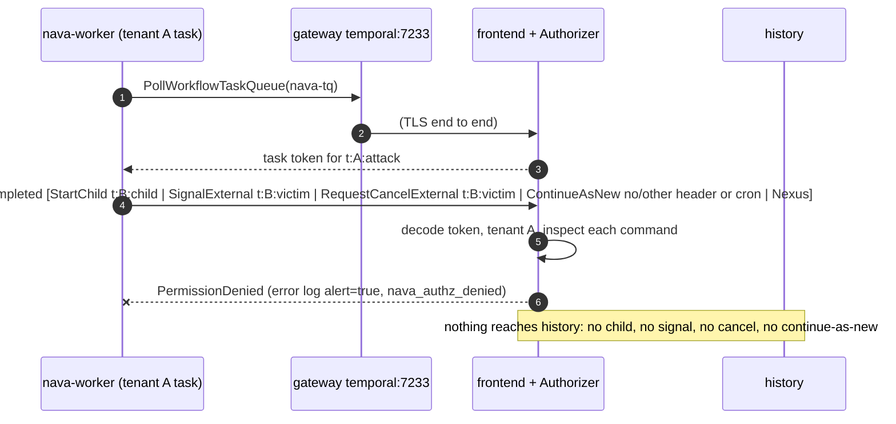
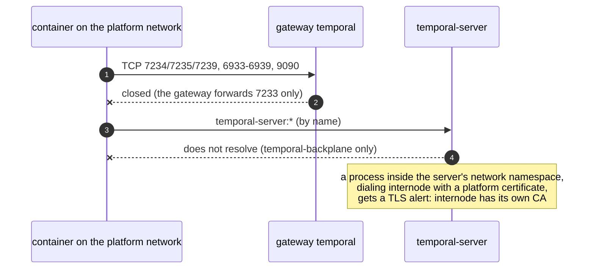

## CI-6 first block: certificate, network and Authorizer (T32a)

The live adversarial suite for the custom Temporal server. It runs against the
compose Temporal over mTLS, through the gateway, with the real Authorizer. Nothing
is stubbed. Source of the rules: ADR-001 Annex B CI-6 and Annex A.2, erratum E1
(TICK-83), and the D9 workload allow-list (ADR-001-A1).

- Tests: `internal/temporalstack/ci6_isolation_test.go` (helpers in
  `ci6_helpers_test.go`). Every test is named `TestCI6_*`. The file name matches
  the `**/*isolation*_test.go` pattern in `docs/delivery/review-paths.yaml`, so
  removing it, or adding a skip to it, needs CTO sign-off.
- Run: `make stack-up`, then `make stack-test-sdk`. To run a second stack on the same host, set `COMPOSE_PROJECT_NAME` and the port variables, then point the tests at it with `NAVA_TEST_COMPOSE_PROJECT` and `NAVA_TEST_TEMPORAL_ADDR`. This writes the report
  (`ci6-report.md`) through `tools/ci/ci6report`. The CI `stack` job already runs
  this step. Uploading the report as the `ci6-report` artifact needs a change to
  `.github/workflows/ci.yml`, which is attached to TICK-79 because the agent token
  cannot push workflow files. The step fails if a contract case fails, is skipped or is
  missing.
- Last local report: [`ci6-report.md`](ci6-report.md).

### Threat model

The attacker is a platform process that holds one valid certificate: `nava-relay`,
`nava-core`, `nava-worker` or `nava-operator`. Or it holds a certificate it should
not have: one from another CA, or one from the installation CA whose CN is not an
identity. The attacker wants to reach another tenant's workflows (`t:B:*` from a
`t:A:*` task), an API outside its row, or the server's internal ports.

### Cases and how each is proven

| Case | Proof |
|---|---|
| Rogue CA | A `nava-relay` certificate signed by a fresh CA, and no certificate at all, each get a TLS alert from the server. The real `nava-relay` certificate gets none (control). |
| Unlisted CN | `nava-unknown`, from the installation CA (`make dev-ca` writes it and nothing mounts it), passes the handshake. Every call is then `PermissionDenied`. The log has a `reason=no_identity` line for each call, after this run's anchor (a deny that carries a unique namespace). `nava_authz_denied{identity=none,reason=no_identity}` rises by at least 5, and the denied start's workflow id is `NotFound`. |
| Internal ports | One container on `internal` gets OPEN for `temporal:7233` (control) and CLOSED for every internode, membership and metrics port, on `temporal` and on `temporal-server`. |
| Internode handshake | Run inside the server's network namespace. History (7234) and matching (7235) serve the internode certificate (control) and refuse all five platform certificates. 7239 has no listener at v1.29.7. |
| Allow-list sweep | For `nava-relay`, `nava-core`, `nava-worker` and `nava-operator`, every unary method in `temporal-server/authz/testdata/allowlist.golden.md` that is not on the identity's row is `PermissionDenied`. Each request carries namespace `nava`, so it reaches the Authorizer. Real requests aimed at a running tenant-B workflow leave it RUNNING and unsignaled. |
| Operator pinned list | `ReapplyEvents`, `ImportWorkflowExecution`, `DeleteWorkflowExecution` (admin and workflow service) and `DeleteNamespace` are each aimed at a real victim and at `nava`. Each is denied, with an `api_not_allowed` log line after this run's anchor, and `nava_authz_denied` rises by at least 5. The victim and the namespace survive. |
| Worker commands (E1) | A raw `nava-worker` poll takes the task of a fresh `t:A:` workflow and answers it with the attack command. The test requires `PermissionDenied`, an `alert=true` error log line (certificate, workflow id, command, reason), a rise in `nava_authz_denied{identity,reason,command}`, and no `WorkflowTaskCompleted` in the attacker's history: a denied response never reaches history, whatever the command. The cross-tenant tests also check the victim's history. |
| Token | An undecodable token is denied with `task_token_invalid`. A real task of an unprefixed workflow id (started by `temporal-system`, which is exempt) is denied with `workflow_id_no_tenant`, under the same four checks as the worker commands. |
| Allowed | A real SDK worker, whose propagator adds `nava-tenant`, runs a parent that starts a same-tenant child, and both complete. Each SDK identity dials and its worker starts. |

A mutation check was run by hand. With the child target switched to the
attacker's own tenant, the cross-tenant child test fails: the call is allowed and
no alert is logged. So the deny depends on the tenant, not only on the command
type.

### Observations (none exploitable)

1. **The undecodable-token deny alerts in the log but would not page.** Status:
   will bite us at scale. Severity: Low. A `task_token_invalid` or
   `request_malformed` deny carries `command="none"`. The two rules in
   `docs/temporal-server.md` page on `command!="none"`, or on a list of D9
   reasons that leaves both out, so neither rule fires on these denies. The rules
   are not installed yet (TODO-004). Fix: add `task_token_invalid|request_malformed`
   to the reason list of the second rule when TODO-004 installs them.
2. **Prometheus rewrites label values.** Severity: Low. The server's reporter
   replaces every character outside `[A-Za-z0-9_]`, so the series reads
   `identity="nava_worker"` and `api="_temporal_api_workflowservice_v1_WorkflowService_..."`.
   A rule that filters on `identity="nava-worker"` would never match. The
   documented rules do not filter on identity or api today. Whoever writes them
   under TODO-004 should use the rewritten values.
3. **For a few calls, the namespace check runs before the Authorizer.** Severity:
   none. A call to a task-token API with no namespace and no token gets
   `InvalidArgument` ("Task token not set") instead of `PermissionDenied`. The
   answer depends only on the shape of the request and reveals no tenant data.
