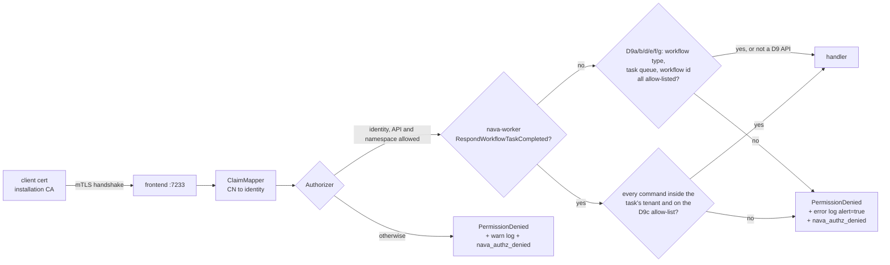

# Custom Temporal server (`temporal-server/`)

ADR-001 D22 and Annex A.2, plan task T27a. A separate Go module (R7) that builds
Temporal `go.temporal.io/server` v1.29.7 + `go.temporal.io/api` v1.53.0 (ADR-001-A1;
main schema 1.18, visibility 1.9) with a
deny-by-default Authorizer and a certificate ClaimMapper, plus worker command
inspection (T27b, ADR-001 erratum E1, tightened by T27c) and the D9 workload
allow-list (T27e, ADR-001-A1; extended by T27i, ADR-001-A2). Compose wiring (T28) is in `compose.yaml` and `deploy/compose/README.md`.



## Rules

- **Identity** comes only from the verified client certificate's CN:
  `nava-relay`, `nava-core`, `nava-worker`, `nava-operator`, `temporal-system`.
  Any other CN, no certificate, or a bearer token gives no identity and is denied.
- **API**: the per-identity lists in `temporal-server/authz/policy.go`.
  `nava-worker` gets only the task-token forms of `RespondActivityTask*`; the
  `*ById` forms act on any workflow id and are denied (T27c; M1 has no async
  completion).
  `temporal-system` (the server's system worker) is allowed everything.
- **Namespace**: an API whose request has a `namespace` field must target `nava`;
  an API without one (for example `GetSystemInfo`) must target none.
- `grpc.health.v1.Health/Check` is allowed for every caller, for probes.
- The full generated table is `temporal-server/authz/testdata/allowlist.golden.md`.

## Command inspection (T27b, erratum E1; T27c)

For `RespondWorkflowTaskCompleted` from `nava-worker` the Authorizer reads the
request (`authz/commands.go`). The task's tenant is the `<tenant>` of the task
token's workflow id `t:<tenant>:…`. One bad command denies the whole response.

| Denied when | `reason` |
|---|---|
| the task token does not decode | `task_token_invalid` |
| its workflow id has no `t:<tenant>:` prefix | `workflow_id_no_tenant` |
| the request body is missing or not a `RespondWorkflowTaskCompletedRequest` | `request_malformed` |
| a command type is not on the E1 allow-list (Nexus, `Unspecified`, any type a later API adds) | `command_not_allowed` |
| child / signal-external / cancel-external targets a namespace other than `nava` (empty means the task's own, `nava`) | `command_namespace` |
| … or a workflow id with another tenant's prefix, or none | `command_cross_tenant` |
| schedule-activity without a `nava-tenant` header equal to the task's tenant | `activity_header` |
| child (same-tenant target) without a `nava-tenant` header equal to the task's tenant | `child_header` |
| continue-as-new without a `nava-tenant` header equal to the task's tenant | `continue_as_new_header` |
| continue-as-new with `cron_schedule` | `continue_as_new_cron` |
| child, continue-as-new or upsert sets `NavaTenantId` to anything but the task's tenant (unset is allowed) | `search_attribute_tenant` |

The `nava-tenant` header and `NavaTenantId` must be default-converter string
payloads (`json/plain`, a JSON string); anything else counts as missing.
`temporal-system` is not inspected. `TestCommandNamesCoverPinnedEnum` fails when
a Temporal upgrade adds a command type, until it is classified.

## Workload allow-list (T27e, ADR-001-A1 D9)

Temporal's own system workflows (`temporal-sys-*`) run on reserved queues and
are processed by the system worker as `temporal-system`, which may do anything.
So a platform identity must never name a workflow type or task queue it does not
own (S1: a relay start of `temporal-sys-batch-workflow` terminated another
tenant's workflow). A request is allowed only if **every** workflow type, task
queue and workflow id it names is on the compiled-in allow-list in
`authz/policy.go` (`platformWorkflowTypes = {nava.interpreter}`,
`platformTaskQueues = {nava-tq}`; `nava.interpreter` is the one generic type every
workflow definition runs as, PLAN-003 D-3-11). The two M1 smoke types were
removed in TICK-374: the stack
tests register their own bodies as `nava.interpreter`, so CI-6 runs the
allow-list we ship, and `authz/workload_smoke_removed_test.go` asserts that the
old types are denied. There is no deny-list. `temporal-system` is
exempt. Adding an entry is a policy PR with Security review; the golden table
prints both sets.

| Part | Checked | Denied when | `reason` |
|---|---|---|---|
| D9a | `nava-relay` `StartWorkflowExecution`, `SignalWithStartWorkflowExecution` | type not in the set (empty included) | `workflow_type_not_allowed` |
| | | queue kind not NORMAL / UNSPECIFIED | `task_queue_kind_not_allowed` |
| | | queue name not in the set | `task_queue_not_allowed` |
| | | workflow id without `t:<tenant>:` | `workflow_id_no_tenant` |
| D9a | `nava-relay` `SignalWorkflowExecution` | workflow id without `t:<tenant>:` | `workflow_id_no_tenant` |
| D9b | `nava-worker` `PollWorkflowTaskQueue` | NORMAL queue not in the set | `task_queue_not_allowed` |
| | | STICKY name not `<host>:<uuid>`, or in the set, or `NormalName` not in the set (empty included) | `sticky_queue_not_allowed` |
| D9b | `nava-worker` `PollActivityTaskQueue` | STICKY (activities have no sticky queue) | `task_queue_kind_not_allowed` |
| | | queue not in the set | `task_queue_not_allowed` |
| D9c | `ScheduleActivityTask` | queue set and not in the set | `task_queue_not_allowed` |
| D9c | `StartChildWorkflowExecution`, `ContinueAsNewWorkflowExecution` | type not in the set (empty is denied, not inherited) | `workflow_type_not_allowed` |
| | | queue set and not in the set | `task_queue_not_allowed` |
| D9c | `ScheduleActivityTask`, `StartChildWorkflowExecution`, `ContinueAsNewWorkflowExecution` | queue kind not NORMAL / UNSPECIFIED | `task_queue_kind_not_allowed` |
| D9c | `StickyAttributes` (`command=StickyAttributes`) | the D9b STICKY rule fails | `sticky_queue_not_allowed` |
| D9b+ | `nava-worker` `PollWorkflowTaskQueue`, `PollActivityTaskQueue` | `DeploymentOptions.WorkerVersioningMode` not unspecified / `UNVERSIONED`, or `WorkerVersionCapabilities.UseVersioning` true | `worker_versioning_not_allowed` |
| D9d | `nava-worker` `RespondWorkflowTaskFailed`, `RespondActivityTaskCompleted` / `Failed` / `Canceled`, `RecordActivityTaskHeartbeat` | task token does not decode as `token.v1.Task` | `task_token_invalid` |
| | | token workflow id without `t:<tenant>:` | `workflow_id_no_tenant` |
| D9d query clause | `nava-worker` `RespondQueryTaskCompleted` | task token does not decode as `token.v1.QueryTask` | `task_token_invalid` |
| | | token task queue neither in the set nor `<host>:<uuid>` | `task_queue_not_allowed` |
| D9e | `nava-worker` `GetWorkflowExecutionHistory` | workflow id without `t:<tenant>:` | `workflow_id_no_tenant` |
| D9f | `nava-core` `RequestCancelWorkflowExecution`, `UpdateWorkflowExecution`, `QueryWorkflow`, `DescribeWorkflowExecution`, `GetWorkflowExecutionHistory` | workflow id without `t:<tenant>:` (empty included) | `workflow_id_no_tenant` |
| D9g | `nava-worker` `ShutdownWorker` | `StickyTaskQueue` set and not `<host>:<uuid>`, or in the set | `sticky_queue_not_allowed` |
| | `ShutdownWorker`, `RecordWorkerHeartbeat`, `PollWorkflowTaskQueue`, `PollActivityTaskQueue` | a present `WorkerHeartbeat` whose `TaskQueue` is not in the set (empty included) | `task_queue_not_allowed` |
| D9h-links | `nava-relay` `StartWorkflowExecution` (`links`, `completion_callbacks[].links`), `SignalWithStartWorkflowExecution`, `SignalWorkflowExecution`; `nava-core` `RequestCancelWorkflowExecution` | a link that is not a workflow event link, or whose workflow id has no `t:<tenant>:` | `workflow_id_no_tenant` |
| D9h-failures | `nava-relay` `StartWorkflowExecution` (`continued_failure`); `nava-worker` `RespondWorkflowTaskFailed`, `RespondActivityTaskFailed`, `RespondQueryTaskCompleted`; `RespondWorkflowTaskCompleted` query results and `FailWorkflowExecution`, `RecordMarker`, `ContinueAsNewWorkflowExecution` commands; the update `messages` of `RespondWorkflowTaskCompleted` and `RespondWorkflowTaskFailed` (`Rejection.failure`, `Response.outcome.failure`; `command=Message`, `command_index` is the message's) | a `ChildWorkflowExecutionFailureInfo` workflow id anywhere along the `cause` chain without `t:<tenant>:` | `workflow_id_no_tenant` |
| | worker task-token paths (all of the above except the relay's start and `RespondQueryTaskCompleted`, whose token names no workflow) | that workflow id names another tenant than the task's | `command_cross_tenant` |
| | update `messages` | a body that is not an update `Acceptance`, `Rejection` or `Response`, or does not decode | `protocol_message_not_allowed` |

A missing or mistyped request body is `request_malformed`. The sticky rule
exists because, at server v1.29.7, a sticky partition and the normal partition
of the same name share a key, so a STICKY poll named `temporal-sys-per-ns-tq`
would receive the system worker's tasks.

D9b+ to D9g are ADR-001-A2 (T27i). Task tokens are unsigned protos, so D9d
checks the token's own workflow id with the same decode as E1 (`taskTokenTenant`).
D9b+ stops a versioned poll from making matching start the
`temporal-sys-worker-deployment*` workflows in `nava`. D9g stops `ShutdownWorker`
force-unloading the `nava-tq` root partition. D9e and D9f prove the workflow is
*a* tenant's, not *which* tenant's: the `nava-core` and `nava-worker`
certificates carry no tenant. `nava-operator` stays outside D9.

D9h and the poll-heartbeat and Kind clauses of D9g and D9c are T27k's
(TICK-133). They enforce ADR-001-A2 Annex A.2's statement that every workflow id
and task queue an allow-listed API names is checked. The CI-C drift golden,
`temporal-server/authz/testdata/request-fields.golden.md`
(`TestRequestFieldGolden`), lists every request field of the `nava-relay`,
`nava-core` and `nava-worker` APIs with the rule that checks it. A
`go.temporal.io/api` bump that changes a field, or an id- or queue-shaped field
with no rule, fails CI until a policy PR classifies it.

## Drift checks (run on every Temporal upgrade)

`authz/policy_test.go` reflects over the `WorkflowService`, `OperatorService`
and `AdminService` gRPC descriptors at the pinned versions and fails if:

- a descriptor method is neither allow-listed nor in `deniedByDefault`, or is in both;
- a listed method no longer exists;
- `policy.go` disagrees with the ADR rules (written as rules with the ADR's wildcards);
- any (identity, method, namespace) decision differs from those rules;
- the golden table is stale (`go test ./authz -run TestAllowListGolden -update`).

`gomod_test.go` fails on any `replace`, any dependency on a platform module, a
direct `go.temporal.io/sdk` dependency, or a moved pin.

The five methods new at api v1.53.0 (`DescribeWorker`, `FetchWorkerConfig`,
`UpdateWorkerConfig`, `SetWorkerDeploymentManager`, `UpdateTaskQueueConfig`)
are in `deniedByDefault`, `DescribeWorker` included even though the operator's
`Describe*` rule would match it (ADR-001-A1, TICK-121). api v1.53.0 adds no
command type.

## Vulnerability gate

`make vulncheck-temporal-server` is a required step of the `temporal-server` CI
job and of `make ci-lint`. It must report zero findings. There is no exception
and no allowlist (ADR-001-A1 Decision 3): a finding is a new decision for the
triad, not a pin bump in passing.

## Observability

Each API deny logs `Temporal API call denied` (warn) with `identity`, `api`,
`namespace`, `reason`, `command` (`none`), `cert_subject`, `cert_serial`,
`cert_issuer`. Each command deny logs `Temporal workflow command denied`
(**error**, `alert=true`) with the same fields plus `workflow_id`,
`command_index`, `target_workflow_id` (when the command has one) and `detail`.
Each D9 request deny (D9a, D9b(+), D9d to D9h) logs `Temporal workload denied` the same way (`command`
`none`, `command_index` `-1`); the type or queue name is in `detail`.
Both increment `nava_authz_denied{identity,api,namespace,reason,command}`.

Metric tags are bounded: `none`/`other` for unknown values, `command` is a
command type name, `StickyAttributes`, `Message` or `unknown`. Workflow ids, types and
queue names are client-supplied and unbounded, so they are in the log line
only, never in a tag. The Prometheus
reporter rewrites `-` and `/` in tag values to `_`. The caller only sees a
generic `PermissionDenied`.

A denied workflow task retries until someone acts, so every command deny must
page. The alert rule, once an alerting backend exists (not in M1 compose):

```yaml
- alert: TemporalWorkflowCommandDenied
  expr: sum by (reason, command) (increase(nava_authz_denied{command!="none"}[5m])) > 0
  labels: {severity: page}
  annotations:
    summary: "nava-worker sent a cross-tenant or unlisted workflow command"
    description: "Find workflow_id and the certificate in the error log line 'Temporal workflow command denied'."
- alert: TemporalWorkloadDenied
  expr: sum by (identity, reason) (increase(nava_authz_denied{command="none", reason=~"workflow_type_not_allowed|task_queue_not_allowed|task_queue_kind_not_allowed|sticky_queue_not_allowed|workflow_id_no_tenant|worker_versioning_not_allowed|task_token_invalid"}[5m])) > 0
  labels: {severity: page}
  annotations:
    summary: "a platform certificate named a workflow type, task queue or workflow id off the D9 allow-list"
    description: "Find the certificate and detail in the error log line 'Temporal workload denied'."
```

## Local use

```sh
make temporal-server-test        # unit, policy, go.mod and in-process end-to-end tests
make temporal-server-image       # builds nava/temporal-server:dev
make temporal-server-run         # dev certs + run the image on :7233 (in-memory SQLite)
```

The `nava` namespace can only be registered with the `temporal-system`
certificate; no other identity may call `RegisterNamespace`.

## Startup refusals (T28; D6-K, ADR-001-A1 and A2)

`checkSecurityConfig` (`cmd/server/check.go`) refuses to start when: frontend
`requireClientAuth` is false; the frontend client CA is not a self-signed root
with path length 0; the same CA is trusted on frontend and internode (internode
ports have no Authorizer, so it has its own CA and certificate); or any D6-K
setting breaks its rule. Each D6-K refusal is a `*SecurityConfigError` naming
the key.

| Key | Refuse start if | Shipped |
|---|---|---|
| `system.disableStreamingAuthorizer` | `true` | `false` |
| `frontend.exposeAuthorizerErrors` | `true` | `false` |
| `system.enableCrossNamespaceCommands` | not `false` (missing refuses) | `false` |
| `worker.enableNamespaceBatcher` | not `false` (missing refuses) | `false` |
| `worker.enableScheduler` | not `false` (missing refuses) | `false` |
| `frontend.enableSchedules` | not `false` (missing refuses) | `false` |
| `frontend.enableBatcher` | not `false` (missing refuses) | `false` |
| `frontend.enableTokenNamespaceEnforcement` | not `true` (missing refuses) | `true` |
| `services.frontend.rpc.httpPort` (static) | non-zero | `0` |

Every value of a key counts, per-namespace constrained ones included, and a
value is read the way the server reads it (`"true"` as a string is true; a
non-bool refuses). "Missing" means no unconstrained value: a namespace-only
value leaves every other namespace on the server default, `true` for every
key where missing refuses. `frontend.enableTokenNamespaceEnforcement` is
required explicitly even though `true` is what it wants, so an upgrade that
changes its default cannot turn it off (A2, F2-3b: the frontend, not the
Authorizer, checks a task token's namespace). The guard
holds each key by its Go symbol (`dynamicconfig.EnableBatcherNamespace.Key()`
and so on), so a key renamed by a Temporal upgrade fails to compile.
`config/dynamicconfig/development.yaml` and
`deploy/compose/temporal/config/dynamicconfig/compose.yaml` set every key
explicitly. The check runs once at startup, on a snapshot of the eight
dynamic-config keys that the server then keeps for its whole life (RS2): a
later edit of the file cannot change any of them, while every other key still
reloads. Hiding a key would not do, because most default to `true`. The
operator's admin
`GetWorkflowExecutionRawHistory[V2]` calls are denied: they skip the namespace
gate and `GetWorkflowExecutionHistory` covers the need.

`temporal-server --bootstrap` registers `nava` and the `NavaTenantId` Keyword
search attribute with the `temporal-system` certificate, so that certificate stays
in the server container. `temporal-server health` and `temporal-server proxy` are
the compose health probe and the 7233-only gateway.

## Operator tunnel to the Temporal UI (T28)

The UI (`docker compose --profile operator up -d`) wields the `nava-operator`
identity, so it publishes no port: a port published on the host is reachable from
platform containers (for example through `host.docker.internal` on Docker
Desktop), which would let them use that identity. Reach it with an explicit
tunnel that lives only while you run it:

```sh
make operator-tunnel        # 127.0.0.1:18233 -> temporal-ui:8080; Ctrl-C closes it
```

While the tunnel runs, that port is reachable from the host like any published
port, so run it only on a developer machine and close it when done. Login through
Keycloak OIDC is deferred until the UI must be reachable without a tunnel.
`stack-test.sh temporal_operator_reach` checks that no platform container reaches
the UI by name or through the host.
