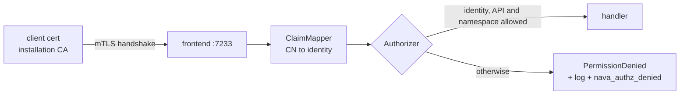

# Custom Temporal server (`temporal-server/`)

ADR-001 D22 and Annex A.2, plan task T27a. A separate Go module (R7) that builds
Temporal `go.temporal.io/server` v1.28.4 + `go.temporal.io/api` v1.50.1 with a
deny-by-default Authorizer and a certificate ClaimMapper. Worker command
inspection is T27b. Compose wiring, PostgreSQL config and the operator-network
restriction are T28.



## Rules

- **Identity** comes only from the verified client certificate's CN:
  `nava-relay`, `nava-core`, `nava-worker`, `nava-operator`, `temporal-system`.
  Any other CN, no certificate, or a bearer token gives no identity and is denied.
- **API**: the per-identity lists in `temporal-server/authz/policy.go`.
  `temporal-system` (the server's system worker) is allowed everything.
- **Namespace**: an API whose request has a `namespace` field must target `nava`;
  an API without one (for example `GetSystemInfo`) must target none.
- `grpc.health.v1.Health/Check` is allowed for every caller, for probes.
- The full generated table is `temporal-server/authz/testdata/allowlist.golden.md`.

## Drift checks (run on every Temporal upgrade)

`authz/policy_test.go` reflects over the `WorkflowService`, `OperatorService`
and `AdminService` gRPC descriptors at the pinned versions and fails if:

- a descriptor method is neither allow-listed nor in `deniedByDefault`, or is in both;
- a listed method no longer exists;
- `policy.go` disagrees with the ADR rules (written as rules with the ADR's wildcards);
- any (identity, method, namespace) decision differs from those rules;
- the golden table is stale (`go test ./authz -run TestAllowListGolden -update`).

`gomod_test.go` fails on any `replace`, any dependency on a platform module, a
direct `go.temporal.io/sdk` dependency, or a moved pin.

## Observability

Each deny logs `Temporal API call denied` (warn) with `identity`, `api`,
`namespace`, `reason`, `cert_subject`, `cert_serial`, `cert_issuer`, and
increments `nava_authz_denied{identity,api,namespace,reason}`. Metric tags are
bounded (`none`/`other` for unknown values); the Prometheus reporter rewrites
`-` and `/` in tag values to `_`. The caller only sees a generic
`PermissionDenied`.

## Local use

```sh
make temporal-server-test        # unit, policy, go.mod and in-process end-to-end tests
make temporal-server-image       # builds nava/temporal-server:dev
make temporal-server-run         # dev certs + run the image on :7233 (in-memory SQLite)
```

The `nava` namespace can only be registered with the `temporal-system`
certificate; no other identity may call `RegisterNamespace`.
